# CalmBar 🌬️

> **macOS 系统增强工具集**：硬件温控、菜单栏收纳、鼠标滚轮解耦、媒体启动拦截、防休眠防离开、充电管理与电池上限、应用去隔离授权、屏幕识字与二维码识别、AI 划词翻译、剪贴板历史、软件卸载与开发缓存清理、启动项与常驻服务管理

[](https://apple.com/macos)
[](https://apple.com)
[](https://swift.org)
[](https://github.com/chao-eng/CalmBar/releases)
[](LICENSE)

---

## 📖 简介

**CalmBar** 用 **Swift 6 + SwiftUI + AppKit** 写成，常驻菜单栏。它主要处理 macOS 日常使用里这些反复出现的麻烦：

1. **散热跟不上负载**。官方 SMC 策略常常要等温度撞了墙才大幅提速。CalmBar 实时读硬件温度，风扇怎么转由你自己定。
2. **菜单栏图标杂乱遮挡**。刘海屏或小屏上第三方图标一多就溢出、被顶掉。CalmBar 提供一键折叠与自动收纳。
3. **鼠标与触控板手势无法分开设置**。macOS 原生设置做不到分别配置滚动方向。CalmBar 把外接鼠标滚轮和原生触控板手势彻底解耦。
4. **Apple Music 被误唤起**。连上 AirPods、误触播放键，系统就强行弹出 Apple Music。CalmBar 拦截掉，并支持改拉起你指定的音乐应用或网页。
5. **长任务休眠与闲置离开判定**。长任务、文件传输、挂机时屏幕自动熄屏休眠。CalmBar 用原生 IOKit 电源断言防休眠，再用 IOHIDSystem 闲置检测模拟轻量微动，降低协同软件的离开判定。
6. **长期满电加速电池损耗**。插电使用电量长期卡在 100%。CalmBar 提供 80% SMC 充电上限与回差巡航，带 15% 底层安全熔断与看门狗。
7. **未签名应用被 Gatekeeper 拦截**。外部下载的软件常因隔离标记报「已损坏」打不开。CalmBar 拖拽即递归去隔离，必要时做 Ad-hoc 自签名修复。
8. **屏幕信息提取要装一堆软件**。CalmBar 原生集成 Apple Vision，做屏幕选区识字、二维码/条码解析与历史管理。
9. **划词翻译要先开网页或加载本地大模型**。CalmBar 走 HTTP OpenAI / HY-MT2 兼容接口，双击 `⌘+C` 或按 `⌥⌘T` 就地悬浮翻译，覆盖中/英/藏/维/粤/蒙等 38 种多语言。
10. **剪贴板只留最后一次复制**。CalmBar 捕获多模态格式、把访达图片智能升格，用 Vision OCR 给文字和二维码建索引，并做隐私过滤。
11. **卸载残留与开发缓存积压**。拖进废纸篓只带走主程序，散落在 Library 里的几个 GB 偏好和缓存还在；Xcode/Node/Python 缓存、已删工程的历史工作区越积越多。CalmBar 提供一键深层卸载与开发者环境清理。
12. **后台自启项失控**。装的软件一多，登录时一堆进程静默拉起，开机变慢、端口被悄悄占用，想关又分不清哪些是系统关键项。CalmBar 把用户自启项、全局代理项与系统守护服务统一纳管，并标出反复崩溃的任务。

---

## 📸 界面预览 (UI Showcase)

<p align="center">
  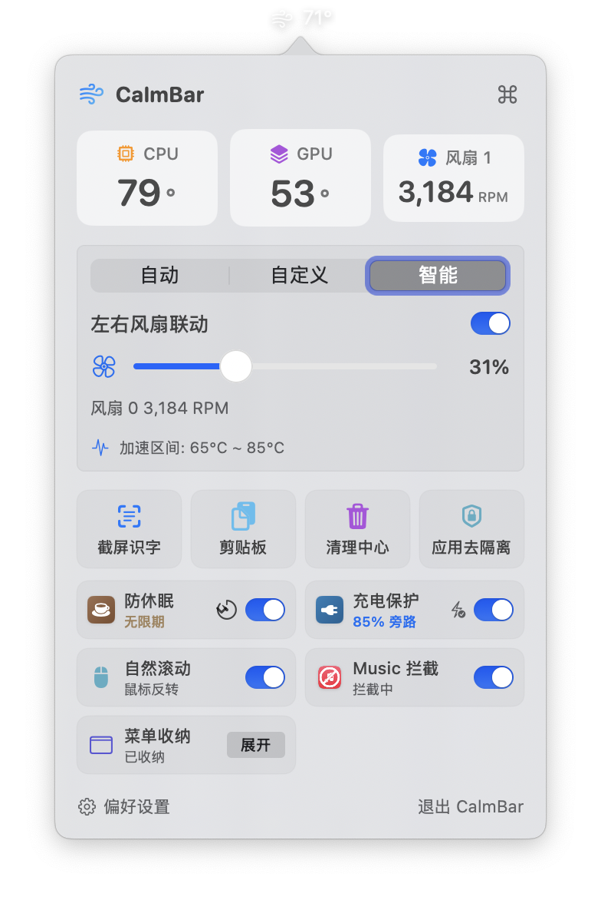
</p>

---

## ✨ 核心功能与操作说明

### 1. ⚡ Command Palette 全局命令面板
* **Spotlight 风格浮动面板**，随时调度全部系统功能与工具。
* **🕹️ 操作说明**：
  1. 按下全局快捷键 `⌥ + ⌘ + K`（或点击菜单栏面板右上角的 `⌘` 图标）唤起命令面板。
  2. 直接输入文字、英文关键词或拼音首字母（如输入 `sz` 找识字、`ql` 找清理、`qidong` 找启动项）。
  3. 用键盘上下方向键选择命令，按 `Enter` 执行。

<p align="center">
  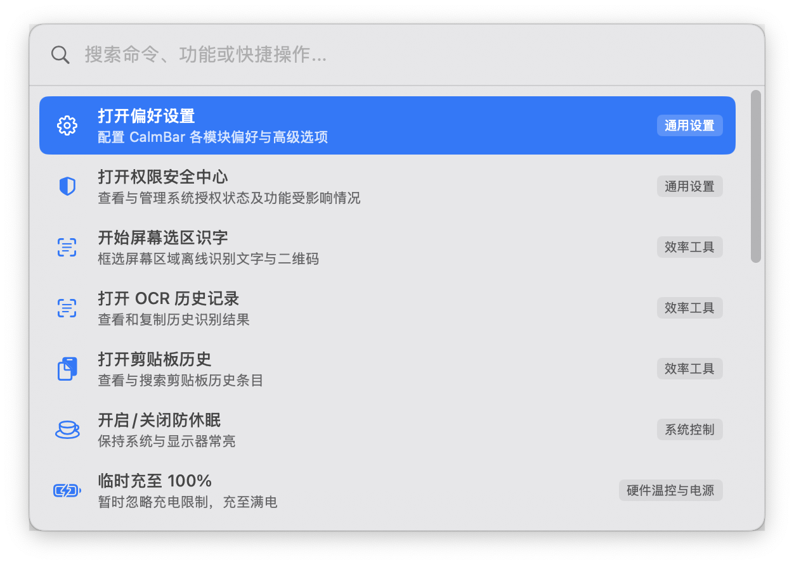
</p>

---

### 2. 🌡️ 硬件监控与智能风扇调控 (Thermal & Fan Control)
* **全芯片温度传感器覆盖**：原生适配 Apple Silicon（M1/M2/M3/M4 系列）及 Intel 机型，实时读取 CPU 核心群簇、GPU 核心、电池与 SoC 模块温度。
* **三档调控模式**：
  * **自动 (Auto)**：交回系统原生默认托管（SMC 官方策略）。
  * **自定义 (Manual)**：无级滑块，可直接锁定指定转速百分比或 RPM。
  * **智能温控 (Smart Curve)**：设定起始加速温度与满速温度，中间按平滑插值加速，兼顾散热与静音。
* **多风扇控制策略**：双风扇机型支持「左右风扇联动调速」与「分别独立控制」。
* **故障安全机制 (Fail-Safe)**：软件退出、重启、系统休眠或异常崩溃时，自动把 SMC 控制权交还 macOS 官方固件，避免硬件过热。
* **🕹️ 操作说明**：
  * 点击菜单栏图标展开主面板，顶部实时显示 CPU/GPU 温度与风扇转速，直接切换三档模式或滑动无级滑块。
  * 打开偏好设置的 **「硬件温控」** 页面，可精确调节智能加速曲线的起始温度与满速温度，并实时查看各个核心传感器的具体度数。

<p align="center">
  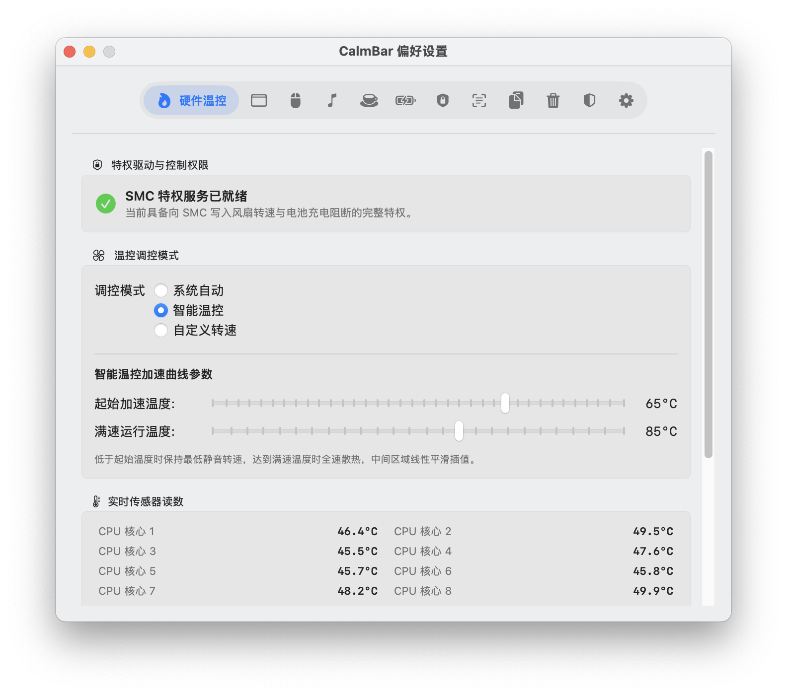
</p>

---

### 3. 🗂️ 菜单栏图标收纳 (Menu Bar Organizer)
* **折叠与展开**：
  * 按住键盘 **Command (⌘)** 键，把需要隐藏的低频图标拖到 **收纳分隔符 `/` 的左侧**。
  * 点击 **`<`** 箭头（或按下快捷键 `⌥ + ⌘ + H`）收起隐藏，再次点击展开。
* **开机静默收纳**：程序启动时默认保持折叠状态，菜单栏开箱即清爽。
* **自动化收纳**：支持配置「展开后无操作 N 秒自动折叠」与「鼠标悬停自动展开」。
* **🕹️ 操作说明**：
  * 在菜单栏主面板点击 **「菜单收纳」** 卡片右侧的「展开/折叠」微按钮即可切换。
  * 在偏好设置的 **「菜单收纳」** 选项卡中，可调整折叠延迟秒数（默认 5 秒）或启用鼠标悬停自动展开。

<p align="center">
  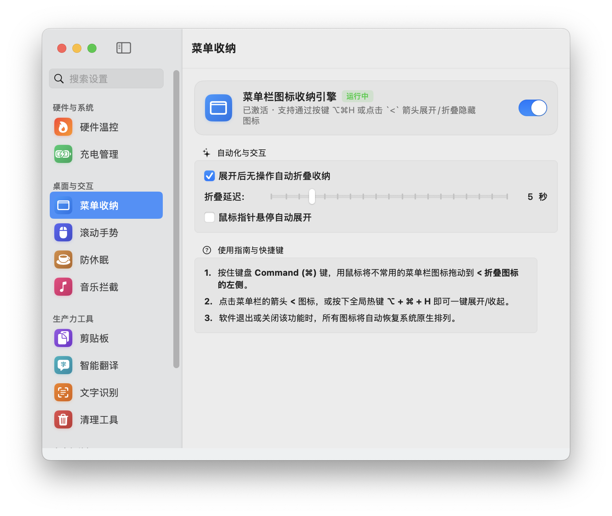
</p>

---

### 4. 🖱️ 外接鼠标自然滚动解耦 (Scroll Reverser)
* **设备级独立配置**：
  * **外接鼠标**：强制反转垂直方向（Y 轴），恢复传统 Windows 风格滚轮习惯。
  * **内建触控板 / Magic Mouse**：100% 保持 macOS 原生自然滚动方向、双指捏合缩放及惯性平滑滑动。
* **低延迟事件拦截**：基于系统级 `CGEventTap` 与精确时序算法，滚动平滑跟手。
* **🕹️ 操作说明**：在菜单栏控制台点击「自然滚动」开关即可开启或关闭鼠标滚轮独立反转，亦可在偏好设置中细分调节 X/Y 轴。

<p align="center">
  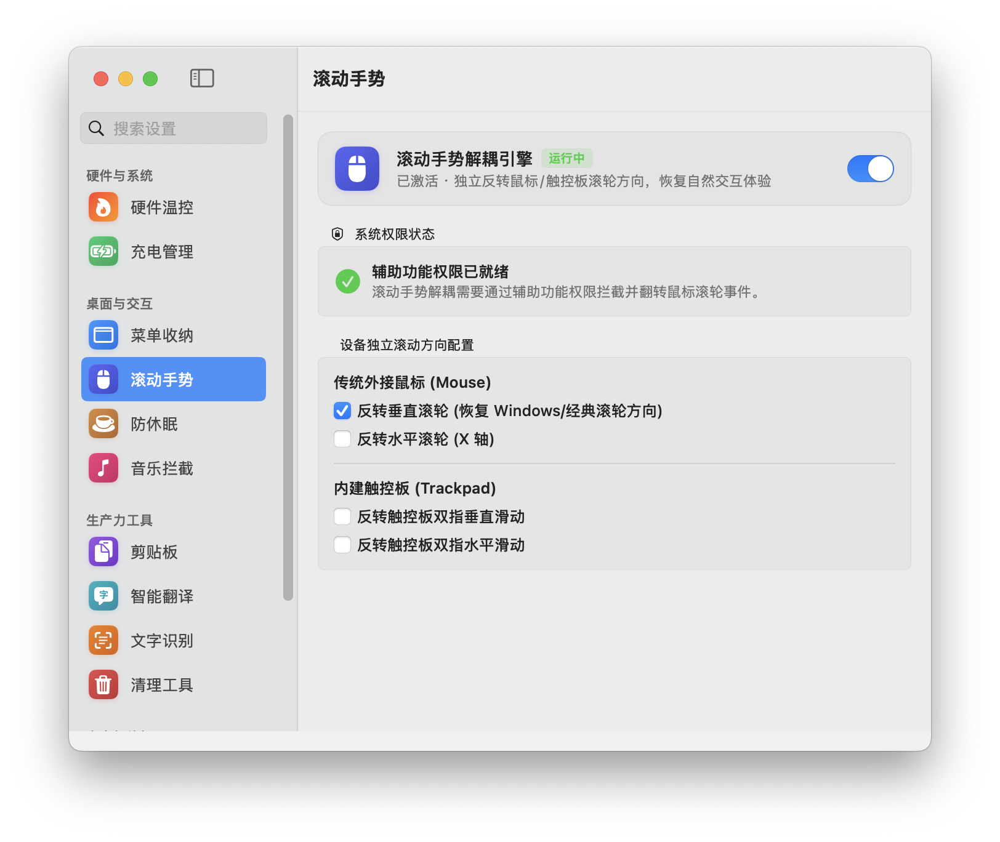
</p>

---

### 5. 🎵 Apple Music / iTunes 启动拦截与替代 (noTunes)
* **拦截系统误唤起**：监听系统应用启动事件，终止 `com.apple.Music` 与 `com.apple.iTunes` 的自动拉起（蓝牙耳机重连、媒体按键触碰等场景）。
* **替代启动 (Replacement)**：
  * 支持自定义替代目标：拦截后自动拉起你指定的第三方音乐 App（如 Spotify、网易云音乐、QQ音乐、TIDAL、foobar2000 等）。
  * 支持配置网页版播放器（如 YouTube Music、Spotify Web、SoundCloud 等）。
* **🕹️ 操作说明**：
  * 开启「Music 拦截」开关后，系统误触唤起 Apple Music 时会被瞬间阻止并关闭。
  * 在偏好设置中的 **「音乐拦截」** 页面，可选择替代模式（仅拦截 / 替代打开指定 App / 替代打开网页 URL），并支持一键关闭当前后台运行的 Music。

<p align="center">
  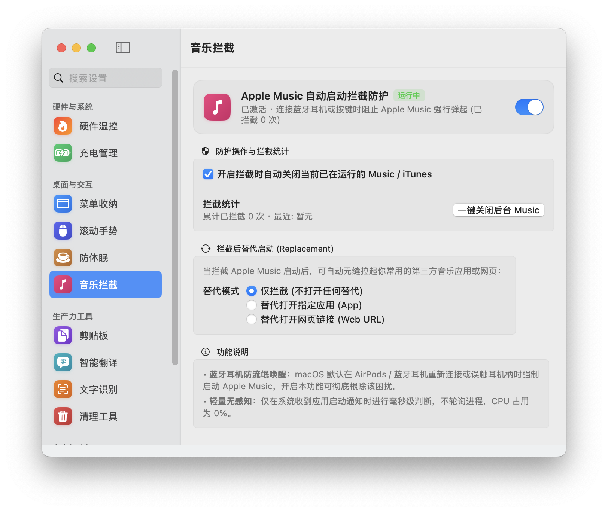
</p>

---

### 6. ☕ 系统防休眠与办公软件防离开 (Caffeine / Keep Awake)
* **IOKit 原生电源断言**：通过 `kIOPMAssertPreventUserIdleDisplaySleep` 阻止显示器休眠、屏幕保护程序与系统睡眠，长耗时渲染、编译及下载不中断。
* **定时预设**：支持无限期保持清醒，或设定 5m / 15m / 30m / 1h / 2h / 5h 倒计时。
* **办公软件防离开仿真 (Keep Apps Active)**：读取 `IOHIDSystem` 真实系统闲置时间，超时后原地发送微幅 HID 微动，重置系统闲置计时器，降低协同办公软件基于闲置时间的 Away 判定。
* **睡眠唤醒与锁屏自适应**：系统睡眠、息屏或多用户锁屏注销时自动挂起微动与轮询；退出 CalmBar 时安全释放所有电源断言。
* **🕹️ 操作说明**：
  * 在主控制台点击「防休眠」开关开启长亮状态；点击 ⏱️ 时钟图标可快捷选择定时保持时长。
  * 在偏好设置的 **「防休眠」** 页面，可开启「防止办公软件闲置离开状态 (Teams / Slack / 飞书 / 钉钉)」，并配置启动时自启与手动睡眠解除策略。

<p align="center">
  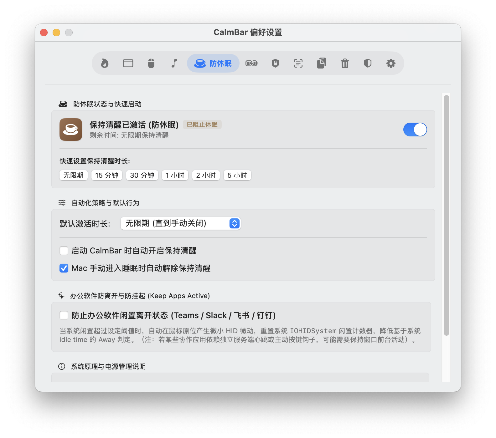
</p>

---

### 7. 🔋 充电管理与电池上限 (Battery Charge Limit)
* **SMC 寄存器充电控制**：向 SMC 写入 `CH0C` / `CHTE` 寄存器指令控制充电逻辑，达到设定阈值（默认 80%）后停止对电池充电，转由电源适配器供电（适用于支持相关寄存器的 Apple Silicon 与 Intel Mac 机型）。
* **回差巡航模式 (Sailing Mode)**：支持配置回差跨度（如 75% ~ 80%）。到达上限后停止充电并转由适配器旁路供电；巡航不主动放电，只有电量因拔掉电源使用或长时间静置自然回落到下限以下时，才恢复涓流补电，避免在 80% 边缘反复高频微充。
* **底层安全熔断 (Safety Melt)**：电量低于 15% 或电池温度过高时，强制终止放电并取消阻断，确保电芯安全。
* **临时充至 100% (Top Up)**：一键临时充满模式，放开限制充至满电后自动恢复设定上限，适合出门前临时蓄电。
* **电池健康监控**：实时展示电池健康度 (Health %)、循环计数 (Cycle Count)、电池温度及供电功率。
* **🕹️ 操作说明**：
  * 开启「充电保护」开关即可把电量锁定在设定上限并转为旁路供电；点击 ⚡ 按钮可临时充至 100%。
  * 在偏好设置中的 **「充电管理」** 页面，可滑动调节目标充电上限（70%~100%）、开启回差巡航模式并查看电池健康度与循环次数。

<p align="center">
  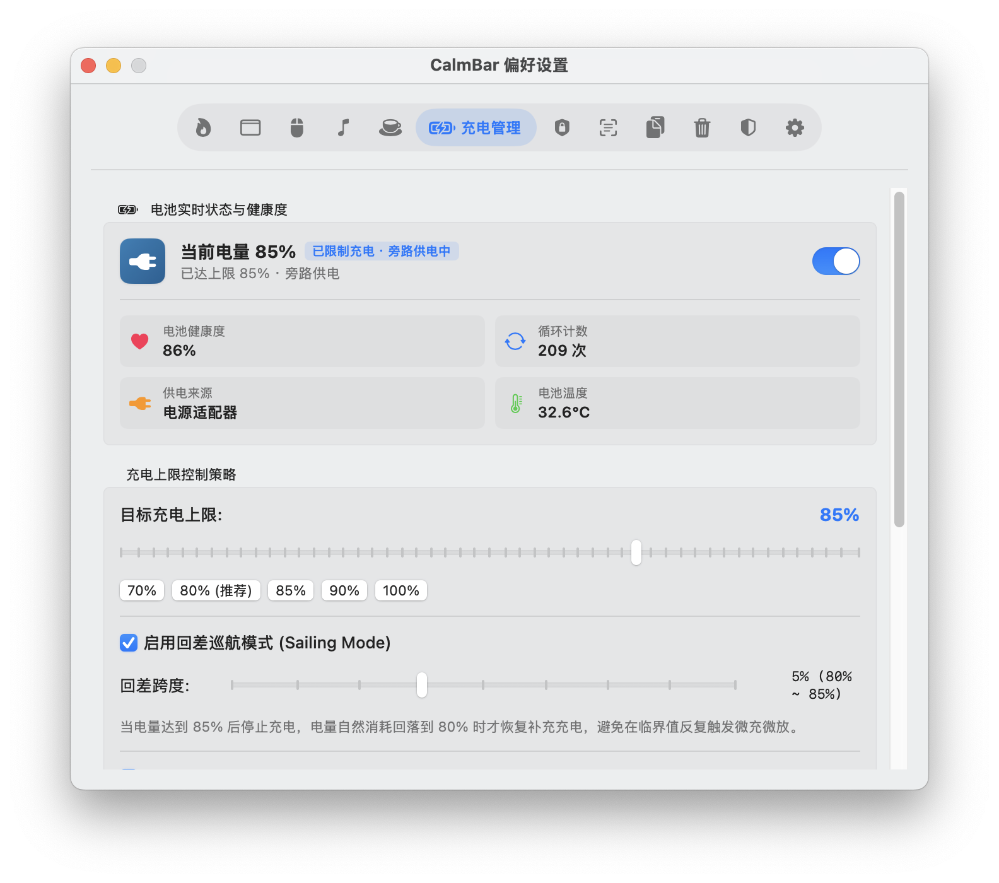
</p>

---

### 8. 🔤 屏幕文字与二维码识别 (Vision OCR & History)
* **Apple 原生深度学习引擎**：基于 macOS 原生 `Vision` 框架高精模型，零第三方二进制体积，内存占用极低。
* **多语言与中英混排**：原生适配简体中文、繁体中文、英语、日语、韩语自动识别与代码混排，符号与汉字不乱码。
* **二维码 / 条形码并发解析**：同时检测选区内文本与二维码/条码内容，网址支持一键 Safari 直达。
* **毛玻璃悬浮窗**：高对比度排版、一键复制、删除记录，可在偏好设置中配置自动倒计时消失（5s~60s）或常驻。
* **🕹️ 操作说明**：
  1. 按下全局快捷键 **`⌥ + ⌘ + O`**（或点击主面板磁贴中的 **「截屏识字」** / 在命令面板输入 `ocr`）。
  2. 鼠标框选屏幕任意区域，识别结果自动复制到剪贴板并弹出半透明结果卡片。
  3. 右键「截屏识字」磁贴可快捷打开 **OCR 历史记录窗口** 检索历史识别内容。

<p align="center">
  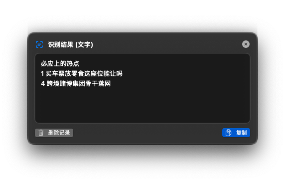
</p>

<p align="center">
  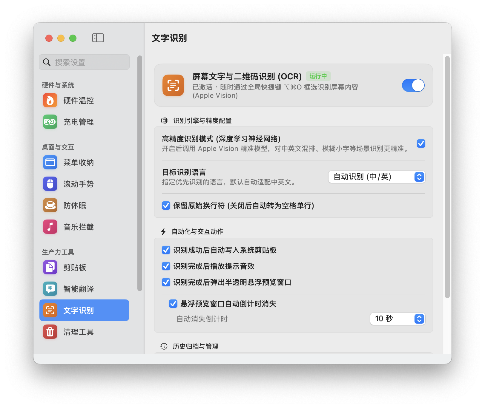
</p>

---

### 9. 🌐 AI 划词翻译与 38 种多语言体系 (AI Translation & HY-MT2)
* **纯 HTTP OpenAI 兼容协议接入**：不捆绑任何本地重型模型，轻量快速。深度适配腾讯混元 **Hy-MT2-1.8B** 专用翻译大模型、Ollama、vLLM 及各类 OpenAI 标准兼容端点，SSE 流式响应。
* **完整支持 38 种多语言体系**：涵盖中文 (zh)、英语 (en)、法语 (fr)、日语 (ja)、韩语 (ko)、繁体中文 (zh-Hant)、**藏语 (bo)**、**维吾尔语 (ug)**、**粤语 (yue)**、**哈萨克语 (kk)**、**蒙古语 (mn)**、印地语 (hi) 等。
* **多维高频交互触发**：
  * **双击 ⌘+C 划词就地翻译**：在任意 App（网页、编辑器、PDF、聊天窗口）中划选文字后，连按两次 `⌘+C` 即可在鼠标光标处弹出毛玻璃翻译浮窗。
  * **全局快捷键 `⌥ + ⌘ + T`**：一键读取当前剪贴板/选区文本进行翻译。
  * **OCR 与剪贴板历史联动**：屏幕选区识字浮窗、OCR 历史记录及剪贴板条目均内置一键【AI 翻译】动作。
* **悬浮交互**：自适应防屏幕边缘越界、支持 Pin 锁定防自动关闭、实时动态倒计时（鼠标悬停智能暂停防误触）、快速切换 38 种目标语言与一键复制译文。
* **📖 专属服务端部署指南**：
  * 👉 [macOS MLX 硬件加速本地部署指南 (Apple Silicon M1~M4)](doc/HyMT2部署/MacOs%20MLX加速部署.md)，利用 Apple Metal GPU 与 4-bit 量化，按需加载 + 20 分钟空闲显存自动释放（显存占用归 0）
  * 👉 [Linux / Docker / NAS / Windows 跨平台部署指南](doc/HyMT2部署/其他系统部署.md)，支持 Docker 单行命令或 Docker Compose 编排 llama-server GGUF 高性能并发部署
* **🕹️ 操作说明**：
  1. 在偏好设置 **「智能翻译」** 中填入 API 基础地址（如本地 MLX `http://127.0.0.1:8000/v1` 或局域网 Docker `http://10.0.8.2:8000/v1`），点击「测试连接」。
  2. 划选任意文本连按两次 `⌘+C` 或按下 `⌥ + ⌘ + T`，即刻在光标旁查看流式翻译结果。

<p align="center">
  
</p>

<p align="center">
  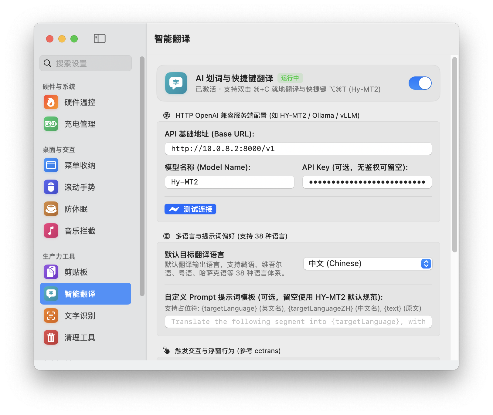
</p>

---

### 10. 📋 剪贴板历史记录与智能识别 (Clipboard History)
* **多模态全格式监听**：纯文本、富文本 (RTF/HTML)、系统截图/复制图像、访达图片/文件 URL、网页链接、十六进制颜色代码等。
* **访达图片智能升格与缩略图**：复制图片文件时自动升格为图片类型并生成高清缩略图与尺寸信息。
* **Vision OCR 后台索引**：自动提取图片中的多语言文字与二维码内容，配合空间感知隔离算法消除噪点，支持全局关键词检索。
* **安全隐私过滤与失焦隐藏**：自动忽略密码管理器（1Password/Bitwarden）敏感数据，支持配置失去焦点时自动隐藏窗口。
* **独立管理窗口与 Pin 固定**：支持分类筛选（文本/图片/链接/文件/已固定）、Pin 固定保护、LRU 淘汰与磁盘缓存管理。
* **快速复制键盘模式**：可在偏好设置中开启「快速复制」，打开窗口后 `↑/↓` 选择记录、`←/→` 切换分类、`⏎` 复制并显示成功反馈，0.5s 后窗口自动关闭，回原应用按 `⌘V` 粘贴；关闭开关即恢复纯鼠标操作。
* **🕹️ 操作说明**：
  1. 按下全局快捷键 **`⌥ + ⌘ + V`**（或点击主面板中的 **「剪贴板」** 磁贴），即可一键唤出或收起独立剪贴板管理窗口。
  2. 顶部支持按「文本 / 图片 / 链接 / 文件 / 已固定」快速筛选，支持搜索框实时模糊检索。
  3. 在偏好设置中可开启「允许窗口失焦隐藏」「快速复制」以及自定义最大存储上限与图片保存策略。

<p align="center">
  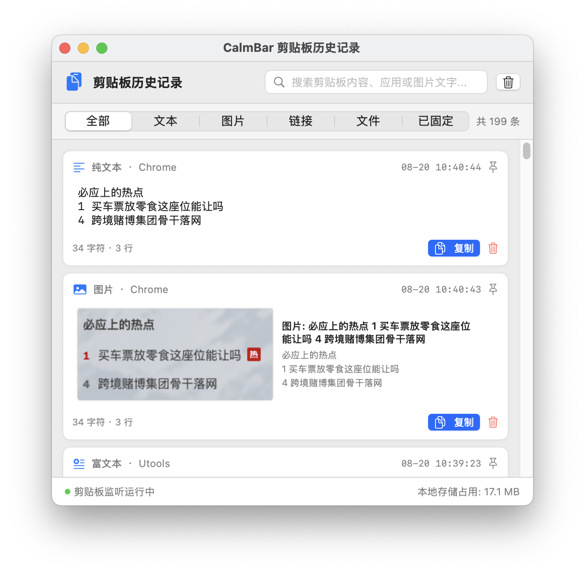
</p>

<p align="center">
  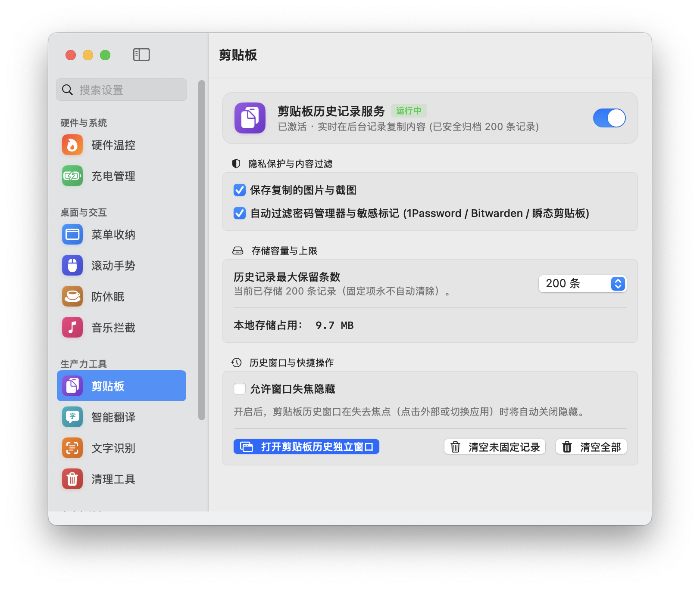
</p>

---

### 11. 🗑️ 软件卸载与开发者深度清理 (App & Developer Cleaner)
* **全量应用索引与架构识别**：多线程并发扫描已安装软件，提取图标、Bundle ID、安装体积、版本号及架构（Apple Silicon / Intel / Universal）。
* **深层残留嗅探**：扫描 `~/Library` 与 `/Library` 下 20+ 个目录，基于 Bundle ID 衍生前缀、名称变体及安全排除列表精准匹配残留文件。
* **免密移入废纸篓**：多层级静默回退，全流程无需输入密码，误删可直接在系统废纸篓放回原处。
* **24+ 款主流开发工具链缓存清理**：覆盖 Xcode（`DerivedData`、`Archives`、`CoreSimulator` 模拟器等）、Node（Npm/Pnpm/Yarn/Bun/Deno）、Python（Pip/Poetry/Uv/Conda）、Rust（Cargo）、Go、Java（Gradle/Maven）、Flutter 等。
* **IDE 孤立工作区清理**：自动探测 VS Code / Cursor 中工程源码已被删除的历史孤立工作区缓存，支持一键批量清理释放数 GB 磁盘空间。
* **🕹️ 操作说明**：
  1. 点击主面板中的 **「清理中心」** 磁贴唤起清理窗口。
  2. **软件卸载**：在左侧列表中点击任意 App，右侧自动勾选所有深层残留，点击 **「移入废纸篓」** 干净卸载。
  3. **开发者清理**：切换至顶部 **「开发者清理」** 选项卡，查看各项工具链占用，一键释放空间。

<p align="center">
  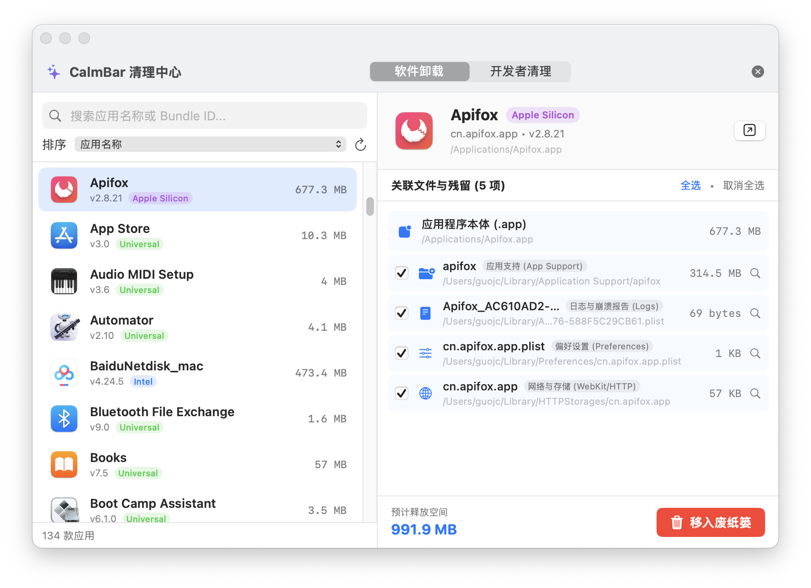
</p>

<p align="center">
  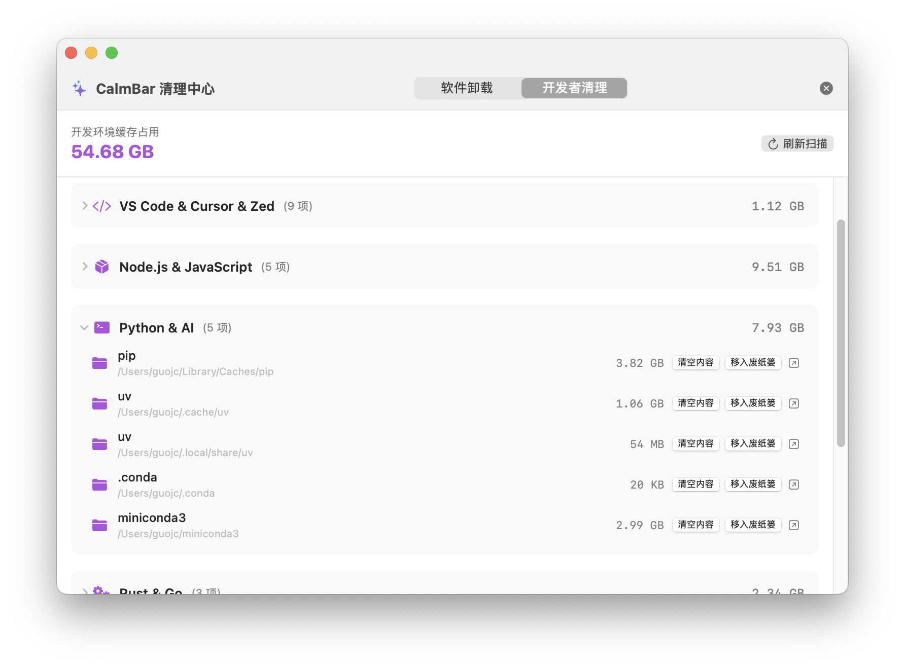
</p>

<p align="center">
  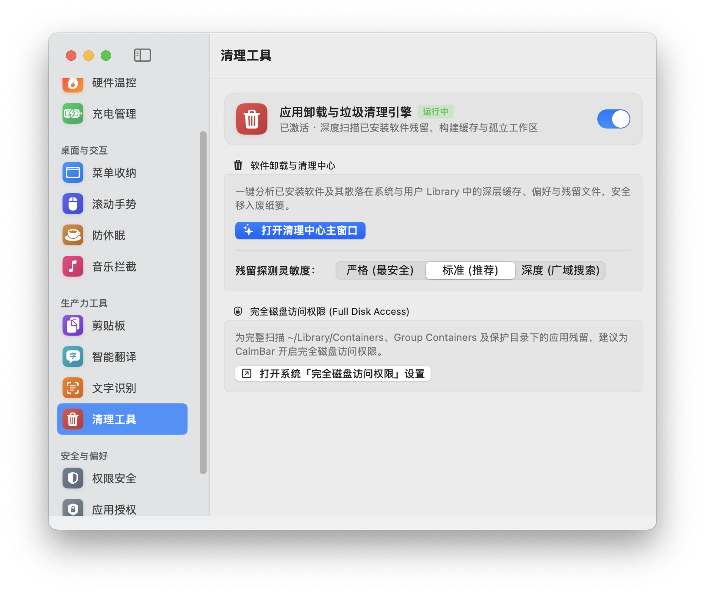
</p>

---

### 12. 🛡️ 未签名与已损坏应用一键授权 (Gatekeeper Quarantine Unlocker)
* **拖拽一键解锁**：直接把报错或未公证的 `.app`、文件夹拖入设置面板，自动执行 `xattr -rd com.apple.quarantine` 解除隔离。
* **深度自签名修复**：勾选「深度修复 (Ad-hoc 重签名)」后，针对签名损坏或修改过的应用执行 `codesign --force --deep --sign -`。
* **免终端无感提权**：结合特权助手 `CalmBarHelper`，处理 `/Applications` 下需要管理员权限的应用时无需反复输入 `sudo` 密码。
* **🕹️ 操作说明**：在偏好设置中进入 **「应用授权」** 页面，直接把打不开或提示损坏的应用拖拽进虚线框中即可自动解除隔离与重新签名。

<p align="center">
  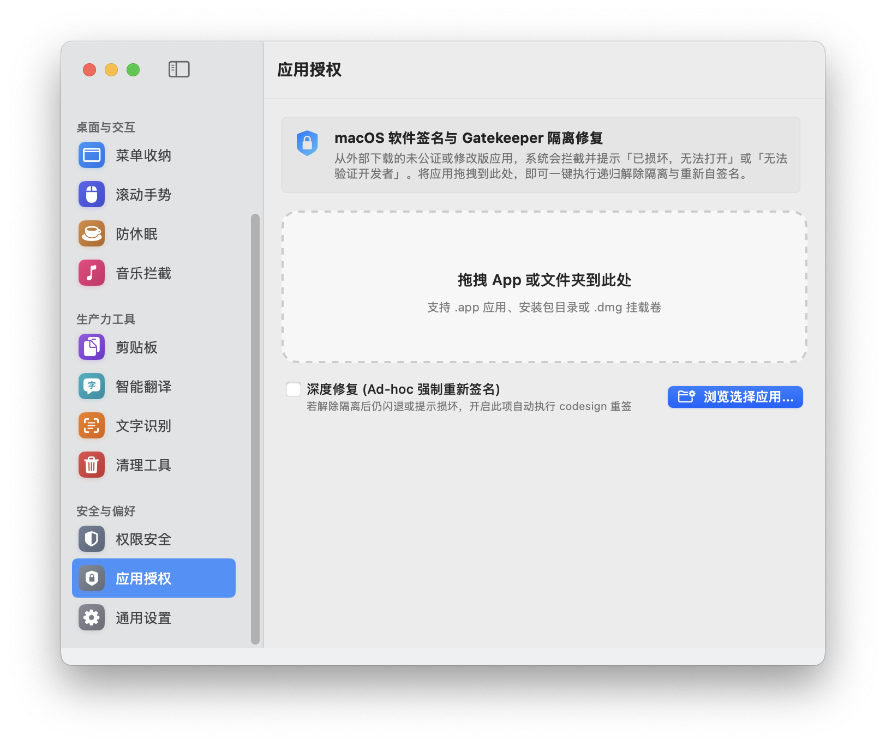
</p>

---

### 13. 🔐 统一权限管理看板 (Permission Center)
* **透明可信的权限管理**：汇总展示辅助功能 (Accessibility)、特权助手 (Privileged Helper)、屏幕录制 (Screen Capture) 与完全磁盘访问权限 (Full Disk Access)。
* **明确使用目的与实时状态**：逐项说明权限对应功能与使用理由，提供一键激活助手与系统设置跳转引导。
* **🕹️ 操作说明**：在偏好设置中点击 **「权限安全」** 选项卡，查看各项底层权限的关联功能与授权状态，支持从系统设置授权返回后自动刷新。

<p align="center">
  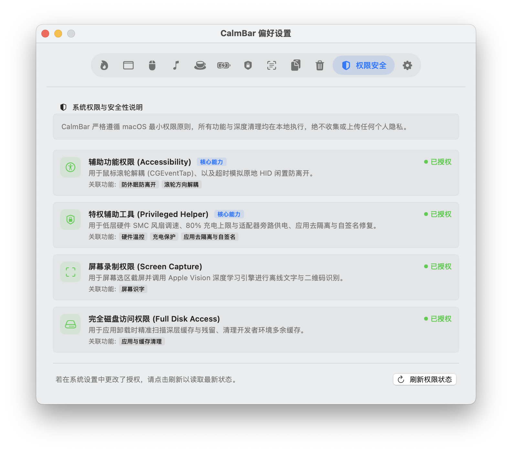
</p>

---

### 14. 🚀 启动项与常驻服务管理 (Launch Manager)
* **全域 launchd 纳管**：用户自启项 (`~/Library/LaunchAgents`)、全局代理项 (`/Library/LaunchAgents`)、系统守护服务 (`/Library/LaunchDaemons`) 统一进一张列表；`/System/Library` 下的 macOS 核心项以「系统保护·只读」呈现，防止误删系统关键进程。
* **现代化 launchctl 指令集**：全面采用 `bootstrap` / `bootout` / `kickstart` / `enable` / `disable`，替代已废弃的 `load` / `unload`；已加载任务按「先 `bootout` → 原子写入 → 再 `bootstrap` → `kickstart -k`」重载，规避现代 `bootstrap` 非幂等导致的 `error 5`。
* **崩溃死循环告警**：综合 KeepAlive 策略、运行态与末次退出码，判定 5 分钟滑窗内连续失败次数是否超阈值（默认 3 次，带 60s 去抖），主面板以红色健康胶囊提示，一键进入崩溃排查视图。
* **本地监听端口透视**：基于 `lsof -iTCP -sTCP:LISTEN`（2.5s 超时熔断）展示本机对外服务的进程、命令行与工作目录，自动关联 Docker 容器名，也支持把运行中的临时服务封装为常驻 LaunchAgent。
* **Crontab 计划任务**：查看与配置系统及用户的周期性定时指令。
* **快照备份与一键回滚**：任何修改/删除前自动生成 Plist 全量快照（文件名携带作用域标识），可在「快照恢复中心」按原作用域无损还原，兼容历史旧格式。
* **双模视图**：普通用户默认进入极简视图（反查所属 App 名称与图标、术语人话化）；开发者模式（需主动开启）解锁端口透视与 Plist XML 源码编辑；表单编辑采用无损字典中间层，完整保留未知键。
* **系统保护与安全提权**：SIP 只读白名单拦截 `/System/Library` 与 `com.apple.*` 关键项；系统级文件写操作经特权助手合并为单一事务，避免授权弹窗风暴。
* **🕹️ 操作说明**：
  1. 点击主面板的 **「自启管理」** 磁贴，或在命令面板输入 `qidong` / `launch` 打开管理窗口（检测到崩溃异常时磁贴自动转红）。
  2. 顶部标签切换「全部自启项 / 用户自启项 / 全局自启项 / 系统守护服务 / Crontab 计划任务 / 异常崩溃告警 / 快照恢复中心 / 服务监听」。
  3. 在偏好设置的 **「自启管理」** 页面，可开启状态栏显示开关，随时查看后台任务状态。

---

### 15. ⚙️ 通用设置与全局快捷键 (General Settings & Hotkeys)
* **开机自启动与菜单栏指示**：支持一键开启登录时静默自启，以及在菜单栏图标旁实时展示硬件 SoC 温度。
* **控制中心自定义展示项**：按需勾选控制中心磁贴与功能卡片的显示与隐藏。
* **全局快捷键总开关**：快捷键速查面板标题栏带总开关，关闭后立即注销 `⌥⌘K / T / O / V / H` 等全部全局热键并停止事件拦截，重新开启即刻恢复；该开关只作用于 `⌥⌘` 系列全局热键，不影响双击 `⌘+C` 划词翻译（后者由「智能翻译」自身的开关控制）。
* **快捷键速查面板**：汇总展示全局 6 大高频快捷键，随心调度系统能力。

<p align="center">
  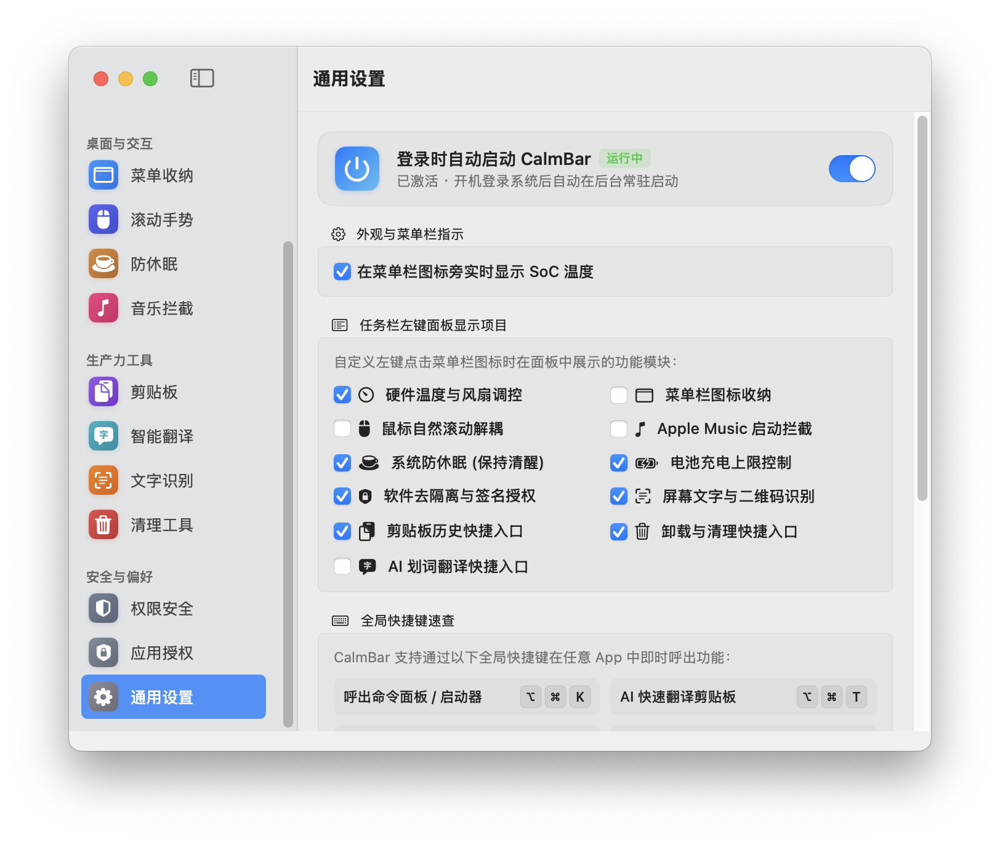
</p>

---

## 🛠️ 技术架构

```text
CalmBar/
├── app/
│   ├── Package.swift                    # SPM 模块与依赖定义
│   ├── build_app.sh                     # 自动编译、签名与打包脚本
│   └── Sources/
│       ├── CalmBar/                     # 主 App 逻辑与 SwiftUI 界面
│       │   ├── AppDelegate.swift        # App 生命周期与菜单栏初始化
│       │   ├── Battery/                 # IOPowerSources 电池监听与充电上限状态机
│       │   ├── Caffeine/                # IOKit 电源断言与 HID 微动防离开引擎
│       │   ├── Cleaner/                 # 应用卸载分析、残留嗅探、开发工具链与工作区清理
│       │   ├── Clipboard/               # 剪贴板监听、安全过滤、OCR 索引与存储管理
│       │   ├── Commands/                # Command Palette 浮动命令面板与调度引擎
│       │   ├── Core/                    # 统一配置、系统事件调度协调器与权限中心管理器
│       │   ├── Features/                # Feature 抽象协议与注册表
│       │   ├── Gatekeeper/              # macOS 隔离属性与自签名修复引擎
│       │   ├── LaunchManager/           # launchd 自启项、守护服务、Crontab 与端口透视
│       │   ├── MenuBar/                 # 菜单栏折叠与布局管理器
│       │   ├── NoTunes/                 # Apple Music / iTunes 启动拦截引擎
│       │   ├── OCR/                     # Vision 文字与条码识别、历史持久化调度
│       │   ├── Recovery/                # RecoveryCoordinator 统一安全恢复与审计日志
│       │   ├── Scroll/                  # CGEventTap 滚轮事件拦截器与权限管理
│       │   ├── Services/                # Service 抽象层与生命周期管理
│       │   ├── Thermal/                 # 温控轮询引擎与 XPC 通信客户端
│       │   ├── Translation/             # HTTP OpenAI & HY-MT2 翻译引擎、双击复制监听、悬浮浮窗与历史
│       │   └── UI/                      # SwiftUI 状态栏控制台、权限安全看板与偏好设置
│       ├── CalmBarKit/                  # 硬件 SMC 读写、安全策略与驱动通信共享库
│       ├── CommandPaletteKit/           # 独立轻量命令面板核心渲染组件
│       └── CalmBarHelper/               # Root 特权辅助工具 (Privileged Helper)
└── doc/
    ├── images/                          # 软件核心功能截图与示例图集
    ├── HyMT2部署/                       # macOS MLX 硬件加速与 Docker 跨平台部署指南
    │   ├── MacOs MLX加速部署.md         # Apple Silicon M1~M4 MLX 硬件加速与空闲释放方案
    │   ├── 其他系统部署.md               # Linux / Docker / NAS llama-server GGUF 部署方案
    │   └── install.sh                   # macOS 一键自动部署脚本
    ├── RELEASE.md                       # 版本发布说明与更新日志
    ├── 核心需求.md                       # 产品需求与架构说明文档
    ├── CalmBar 2.0 优化方案.md           # 2.0 架构与平台化演进方案
    ├── CalmBar 2.0 开发任务步骤.md        # 2.0 任务拆解与交付卡片
    ├── CalmBar 启动项与常驻服务管理接入方案.md  # LaunchManager 模块设计与实现方案
    └── CalmBar 新功能接入模板.md          # 2.0 平台化新功能准入与代码模板
```

---

## 🚀 安装与启动方式

### 1. 下载与安装
从 [Releases](https://github.com/chao-eng/CalmBar/releases) 下载发布的 `CalmBar.app`（或 Zip 压缩包），拖入 `/Applications`（应用程序）文件夹即可。

### 2. 首次运行授权（绕过 Gatekeeper 隔离）
本项目为个人独立开源软件，未集成 Apple 商业付费证书，macOS 直接双击打开时，系统安全机制（Gatekeeper）可能拦截并提示 **“应用程序已损坏，无法打开”** 或 **“无法验证开发者”**。

在终端（Terminal）中执行以下命令移除系统隔离属性即可正常运行：

```bash
sudo xattr -rd com.apple.quarantine /Applications/CalmBar.app
```

> 💡 **提示**：
> * 若应用放置在其他目录，请将路径替换为实际的 `CalmBar.app` 文件路径。
> * CalmBar 内部的 **「应用去隔离」** 功能页面也支持直接拖拽任意 App 一键执行该修复操作。

---

## 📄 开源许可证与致谢

* **GitHub 仓库**：[https://github.com/chao-eng/CalmBar](https://github.com/chao-eng/CalmBar)
* **开源协议**：本项目基于 [Apache License 2.0](LICENSE) 许可证开源。

特别致谢开源社区优秀项目的启发与参考：
* [Pearcleaner](https://github.com/alienator88/Pearcleaner) (macOS App & Dev Cache Cleaner)
* [Aidente](https://github.com/aidente) (SMC Battery Charging Control)
* [Caffeine](https://github.com/caffeine-app) (by Tomas Franzén & Dominic Rodemer)
* [noTunes](https://github.com/tombonez/noTunes) (by Tom Taylor)
* [Scroll Reverser](https://pilotmoon.com/scrollreverser/) (by Pilotmoon)
* [Hidden Bar](https://github.com/dwarvesf/hidden) (by Dwarves Foundation)
* [AirPulse](https://github.com/chaoeng) (SMC Fan Controller)
