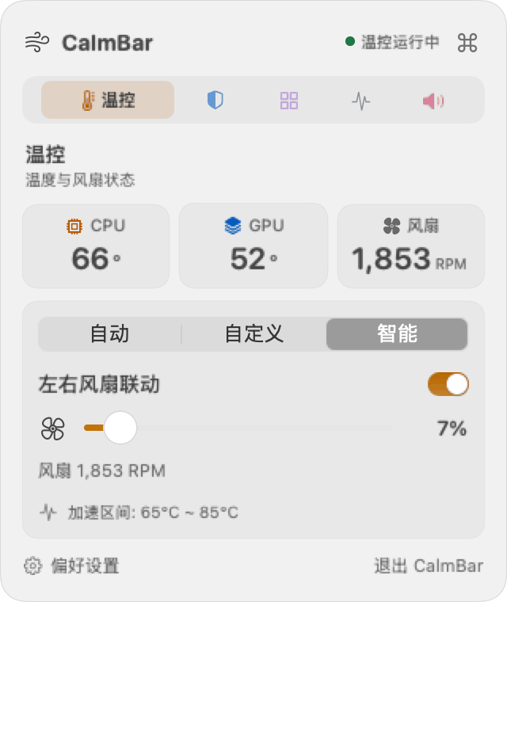

<p align="center">
  
</p>

<h1 align="center">CalmBar</h1>

<hr>

<p align="center">
  <sub>常驻菜单栏的 macOS 工具集，把散热、充电、剪贴板、录屏这些日常操作收进一个面板。</sub><br>
  <sub>Swift 6 + SwiftUI 构建，调用 SMC、IOKit、Vision 等系统原生框架，不装内核扩展。</sub><br>
  <sub>支持 macOS 14.0 及以上，按应用调音量需要 14.4。</sub>
</p>

<hr>

<p align="center">
  <a href="https://apple.com/macos"></a>
  <a href="https://apple.com"></a>
  <a href="https://swift.org"></a>
  <a href="https://github.com/chao-eng/CalmBar/releases"></a>
  <a href="LICENSE"></a>
</p>

<p align="center">
  
</p>

<p align="center">
  <sub>菜单栏面板：温控、守护、工具、监控、声音</sub>
</p>

## 功能一览

| 功能 | 用它能做什么 | 怎么打开 |
| --- | --- | --- |
| 硬件温控 | 实时读取 CPU、GPU、电池与 SoC 温度，风扇支持自动、手动、智能曲线三种策略，双风扇可联动或独立调速；退出或休眠时自动把控制权交还系统 | 主面板顶部，或偏好设置「硬件温控」 |
| 充电保护 | 设定 70%~100% 充电上限，回差巡航减少边缘反复充电，电量低于 15% 强制熔断，可临时充满到 100%；顺带查看健康度与循环次数 | 主面板「充电保护」，或偏好设置「充电管理」 |
| 防休眠防离开 | 用电源断言阻止息屏和睡眠，支持 5 分钟到 5 小时的定时；同时给 Teams、Slack、飞书、钉钉发送 HID 微动，避开闲置离开判定 | 主面板开关与 ⏱️ 按钮，或偏好设置「防休眠」 |
| 菜单栏收纳 | 把低频图标拖到分隔符 `/` 左侧收起来，点 `<` 或按 `⌥⌘H` 展开；支持延时自动折叠和悬停展开 | 主面板「菜单收纳」，或偏好设置「菜单收纳」 |
| 滚轮方向解耦 | 外接鼠标反转垂直滚动，内建触控板和 Magic Mouse 保持原生方向，两套设备互不影响 | 主面板「自然滚动」开关，或偏好设置「滚轮设置」 |
| 音乐启动拦截 | 拦截系统误唤起 Apple Music 和 iTunes，可指定替代的第三方播放器，也可以改成打开网页版 | 偏好设置「音乐拦截」 |
| 音频路由与混音 | 按应用单独调音量、静音、切换输出设备，支持超过 100% 的增益 | 主面板「音频输出」，或命令面板搜「音频」 |
| 屏幕录制 | 录制全屏、指定窗口或框选区域，可同时录系统声音和麦克风，支持开始/停止快捷键 | 面板「屏幕录制」，或 `⌥⌘R` |
| 屏幕识字 | 用 Apple Vision 框选识别中英日韩文字与二维码、条形码，结果自动复制并保留历史 | 面板「截屏识字」，或 `⌥⌘O` |
| AI 翻译 | 双击 `⌘+C` 或按 `⌥⌘T` 就地悬浮翻译；面板「AI 翻译」可手动编辑原文（默认预填剪贴板，不自动翻译）。支持中、英、藏、维、粤、蒙等 38 种语言，兼容 OpenAI 协议和混元 HY-MT2 | 面板「AI 翻译」 |
| 剪贴板历史 | 记录文本、图片、链接、文件与颜色值，图片自动做 OCR 索引，过滤密码管理器内容，支持固定、分类和键盘快速复制 | 面板「剪贴板」，或 `⌥⌘V` |
| 应用与缓存清理 | 卸载应用时一并扫出 Library 下的残留；清理 Xcode、Node、Python、Rust、Go、Java、Flutter 等开发缓存和 IDE 孤立工作区 | 面板「清理中心」 |
| 应用去隔离 | 把提示「已损坏」的应用拖进去，自动执行去隔离，必要时做 Ad-hoc 重签名，处理系统目录时无需反复输密码 | 偏好设置「应用授权」 |
| 启动项与常驻服务 | 统一管理用户自启项、全局代理项、系统守护服务、Crontab；提供崩溃告警、监听端口查看、快照备份与回滚 | 面板「自启管理」，或命令面板搜 `qidong` |
| 权限安全看板 | 汇总辅助功能、特权助手、屏幕录制、完全磁盘访问四类权限，说明用途并显示当前状态 | 偏好设置「权限安全」 |
| 命令面板 | Spotlight 风格浮窗，输入中文、英文或拼音首字母就能找到全部命令，回车执行 | `⌥⌘K`，或面板右上角 `⌘` 图标 |

翻译服务可以本地跑，也可以放在 NAS 或 Docker 里。

- [macOS MLX 硬件加速部署（M1~M4）](doc/guide/HyMT2部署/MacOs%20MLX加速部署.md)
- [Linux / Docker / NAS / Windows 跨平台部署](doc/guide/HyMT2部署/其他系统部署.md)

---

## 技术架构

```text
CalmBar/
├── app/
│   ├── Package.swift              # SPM 模块与依赖（含 Sparkle）
│   ├── build_app.sh               # 通用二进制编译、签名、App Bundle 组装
│   ├── scripts/                   # DMG 打包与版本发布脚本
│   ├── Resources/Info.plist       # 版本号与更新配置的唯一来源
│   └── Sources/
│       ├── CalmBar/               # 主 App，按功能分目录：Thermal、Battery、Caffeine、
│       │                          # Clipboard、OCR、Translation、Recorder、Audio、
│       │                          # Cleaner、Gatekeeper、LaunchManager、MenuBar 等
│       ├── CalmBarKit/            # SMC 读写、安全策略与驱动通信
│       ├── CommandPaletteKit/     # 命令面板渲染组件
│       └── CalmBarHelper/         # Root 特权辅助工具
├── appcast.xml                    # Sparkle 更新源
└── doc/                           # PRD、设计规范、部署指南与发版文档
```

---

## 安装

从 [Releases](https://github.com/chao-eng/CalmBar/releases) 下载 `CalmBar-x.y.z.dmg`。安装包同时包含 Apple Silicon 和 Intel 架构。

应用使用临时签名（ad-hoc），没有走 Apple 公证。macOS Sequoia 及之后版本会在挂载 DMG 前就拦下文件，且弹窗里没有「仍要打开」。先去掉隔离标记再双击：

```bash
xattr -dr com.apple.quarantine ~/Downloads/CalmBar-2.6.0.dmg
```

把 CalmBar 拖进「应用程序」，再对安装后的 App 执行一次：

```bash
xattr -dr com.apple.quarantine /Applications/CalmBar.app
```

之后从 Spotlight 或程序坞正常启动即可。DMG 不在下载目录时替换成实际路径；`/Applications` 没有写入权限时在命令前加 `sudo`。

安装后可以通过「通用设置 → 关于 CalmBar → 检查更新」获取新版本，更新由 Sparkle 完成，不需要重新下载安装包。网络受限时可在「更新设置」里配置 HTTP/HTTPS 代理。

---

## 开源许可与致谢

- **GitHub**：[chao-eng/CalmBar](https://github.com/chao-eng/CalmBar)
- **许可证**：[Apache License 2.0](LICENSE)

参考过的开源项目：

- [Pearcleaner](https://github.com/alienator88/Pearcleaner)（应用与开发缓存清理）
- [Aidente](https://github.com/aidente)（SMC 电池充电控制）
- [Caffeine](https://github.com/caffeine-app)（Tomas Franzén、Dominic Rodemer）
- [noTunes](https://github.com/tombonez/noTunes)（Tom Taylor）
- [Scroll Reverser](https://pilotmoon.com/scrollreverser/)（Pilotmoon）
- [Hidden Bar](https://github.com/dwarvesf/hidden)（Dwarves Foundation）
- [AirPulse](https://github.com/chaoeng)（SMC 风扇控制）
