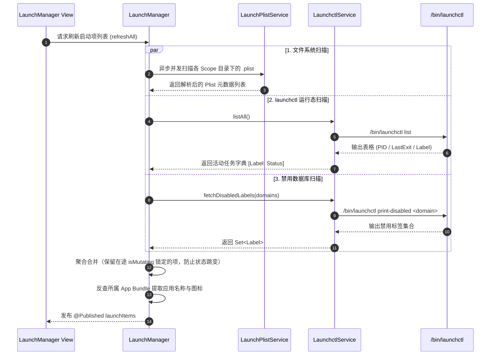

# CalmBar 启动项与常驻服务管理 (LaunchManager) 接入方案

| 项目 | 内容 |
|------|------|
| **文档版本** | v1.1 |
| **状态** | 评审修订定案 (PRD Review Approved) |
| **修订日期** | 2026-10-13 |
| **功能归属** | `FeatureID.launchManager`（系统控制类 · `FeatureCategory.system`） |
| **技术对标** | `reference/LaunchManager-main`（架构、Modern launchctl、进程端口发现） |
| **执行规范** | 严格遵循 `doc/CalmBar 新功能接入模板.md` 的 10 项准入原则 |
| **修订说明** | 经过 `prd-reviewer` 深度四维评审，重构日志防卡死、权限域冲突、并发锁、复杂 Plist 结构与小白易用性 |

---

## 0. 需求背景与设计基线

### 0.1 业务背景与用户痛点
macOS 用户在日常使用与开发过程中，常面临后台任务失控的问题：
1. **暗中常驻与残留堆积**：大量国产/海外商业软件在卸载或关闭后，残留 `LaunchAgents` 或 `LaunchDaemons` 静默开机自启，持续消耗 CPU/内存，甚至陷入频繁崩溃并重启（Crash-looping）的死循环，导致 Mac 发热和电量骤减。
2. **系统设置局限性**：macOS「系统设置 -> 通用 -> 登录项」仅能感知部分常规应用与现代扩展，对于复杂的 `~/Library/LaunchAgents`、全局 `/Library/LaunchAgents`、系统级 `/Library/LaunchDaemons` 以及定时任务缺少直接观测与精确控制能力。
3. **开发者端口冲突排查成本高**：本地开发启动 Web 服务（Next.js / Vite / Go / Python）或数据库时，经常因端口已被某个僵尸后台进程占用而报错，需要手动开终端 `lsof` + `kill`。
4. **服务常驻化门槛高**：开发者写好的本地脚本或微服务希望开机静默常驻，手写 launchd `.plist` XML 格式极其繁琐且易写错键名。

### 0.2 参考项目解析 (`LaunchManager`)
参考开源实现 `LaunchManager`（见 `reference/LaunchManager-main`），其核心设计亮点包括：
- **现代 launchctl 协议栈**：采用 macOS 14+ 推荐的 `bootstrap` / `bootout` / `kickstart` / `enable` / `disable` 现代指令集，替代已废弃过时的 `load` / `unload`。
- **全域 Scope 覆盖**：统一纳管 User Agent (`~/Library/LaunchAgents`)、Global Agent (`/Library/LaunchAgents`)、System Daemon (`/Library/LaunchDaemons`)。
- **双模编辑器**：提供常用字段表单模式（Form）与无损保留未知键的 XML 源码模式。
- **本地常驻端口透视**：通过 `lsof -iTCP -sTCP:LISTEN` 与 Docker 容器联动，支持一键将本地运行的服务转换为持久化 LaunchAgent。

### 0.3 CalmBar 定位契合与能力边界
CalmBar 的产品核心是**轻量、无感、精致、稳定且安全**的系统级效率看板与控制中心：
- **不喧宾夺主**：遵循准入原则第 6 条，主菜单栏常驻仅展示「后台异常/常驻任务健康胶囊」，详细管理均在独立的纯原生 macOS 窗口中承载。
- **双重用户模式隔离**：针对普通用户与开发者严格分流，普通用户默认进入「极简视图」（仅展示常用软件自启与发热崩溃告警），开发者模式需主动开启。
- **安全性加固与防翻车**：`LaunchManager` 开源实现直接以 root 执行提权命令，存在误删系统关键守护进程的风险。CalmBar 引入**系统级只读白名单（SIP保护）**、**操作前自动快照归档（Rollback）**与**崩溃死循环熔断告警**。
- **纳管能力边界界定**：本模块当前版本专注于 macOS 标准 Launchd 体系（`~/Library/LaunchAgents`、`/Library/LaunchAgents`、`/Library/LaunchDaemons`）。macOS 13+ 内嵌于 App 沙盒的 `SMAppService` 登录项将在列表中提供只读状态提示，不直接修改沙盒内部结构。

---

## 1. 新功能设计 10 项准入原则对照表

根据 `doc/CalmBar 新功能接入模板.md`，本项目方案对照如下：

| 准入项 | 规范要求 | 本方案落实策略 |
|---|---|---|
| **1. Feature 元信息** | 唯一 ID、功能名称、归属分类 | `FeatureID.launchManager`，名称「启动项与常驻服务管理」，分类 `FeatureCategory.system` |
| **2. Feature 分类** | 严守 6 大分类边界 | 归入系统控制类 (`system`)，与系统级 `launchctl`、端口生命周期深度联动 |
| **3. Service 边界** | 底层 API 严禁裸写在 UI/Feature 中 | 严格分层：`LaunchctlService`、`LaunchPlistService`、`PortDiscoveryService`、`LaunchBackupService` |
| **4. 权限声明** | 声明依赖，支持优雅降级 | 用户级完全免权限；系统级需要 `.privilegedHelper`（声明为 `.optional`，未授权时只读查看系统项并支持操作用户项） |
| **5. Command 注册** | 注册至少 1 个可执行命令与别名 | 注册 `launchManager.open`、`launchManager.scanPorts`、`launchManager.refresh` 等命令，支持语义化快捷面板调用 |
| **6. Dashboard 准入** | 默认不直接塞满主菜单栏首页 | 首页仅提供 Quick Action 快捷入口与状态栏健康指标胶囊；完整管理器通过独立原生窗口打开 |
| **7. Settings 项** | `AppSettings` 与配置页 Tab 绑定 | 提供开发者模式开关、自动备份快照开关、崩溃任务主动告警阈值及端口扫描刷新频率 |
| **8. Recovery 恢复行为** | 崩溃恢复、退出清理、安全兜底 | **核心机制**：修改/删除 Plist 前自动创建快照，支持一键回滚；禁止篡改 `/System/Library` 系统核心项 |
| **9. 测试清单** | 数据模型单测与逻辑单测 (Swift Testing) | 覆盖 Plist 解析、复杂 KeepAlive 策略、`launchctl list` 解析、原子重载、端口超时熔断单测 |
| **10. 可见失败状态** | 严禁静默失败，统一错误语义 | 定义 `LaunchServiceError`，精准区分权限被拒、Plist 语法错误、超时中断与只读保护提示 |

---

## 2. 核心架构与模型设计

### 2.1 整体分层架构

```mermaid
graph TD
    subgraph UI Layer
        MB[菜单栏 Popover / 异常告警健康胶囊]
        CP[Command Palette 快捷命令]
        LW[LaunchManagerWindowController 独立管理窗口]
        ST[SettingsView / LaunchManagerSettingsTab]
    end

    subgraph Feature Layer
        LMF[LaunchManagerFeature: CalmFeature]
        FM[FeatureManager]
        CC[CommandCenter]
    end

    subgraph Service & Domain Layer
        LMM[LaunchManager 聚合状态调度器]
        LCS[LaunchctlService - 进程/状态调度与原子重载]
        LPS[LaunchPlistService - Plist解析与构建/保留未知键]
        PDS[PortDiscoveryService - 本地端口与Docker探活/带超时熔断]
        LBS[LaunchBackupService - 自动快照与一键回滚]
        LPSV[LaunchPrivilegeService - 提权与批量事务适配器]
    end

    subgraph macOS System Core
        LAUNCHD[/bin/launchctl GUI & System Domains]
        FS[文件系统 ~/Library & /Library]
        LSOF[/usr/sbin/lsof 带2.5s超时的端口探测]
        HELPER[CalmBar Privileged Helper / 批量脚本事务]
    end

    MB -->|打开窗口| LW
    CP -->|执行命令| CC
    CC -->|调用| LMF
    FM -->|装载| LMF
    LMF -->|驱动| LMM
    LW -->|观察状态| LMM
    ST -->|配置绑定| LMM

    LMM --> LCS
    LMM --> LPS
    LMM --> PDS
    LMM --> LBS

    LCS --> LPSV
    LCS --> LAUNCHD
    LPS --> LBS
    LPS --> FS
    PDS --> LSOF
    LPSV --> HELPER
```

---

### 2.2 核心领域模型 (Domain Models)

#### 1. 作用域划分 (`LaunchScope`)
针对 macOS launchd 的执行 Domain 与文件权限分离模型做精确建模：

```swift
public enum LaunchScope: String, CaseIterable, Identifiable, Sendable {
    case userAgent    // ~/Library/LaunchAgents (当前用户自启，免密)
    case systemAgent  // /Library/LaunchAgents (全局用户代理，写文件需特权，运行在用户 GUI Session)
    case systemDaemon // /Library/LaunchDaemons (系统启动即运行，写文件与运行均需特权)
    case appleSystem  // /System/Library/LaunchAgents & Daemons (SIP保护，完全只读)

    public var id: String { rawValue }

    public var displayName: String {
        switch self {
        case .userAgent: return "用户自启项"
        case .systemAgent: return "全局代理项"
        case .systemDaemon: return "系统守护服务"
        case .appleSystem: return "macOS 核心项 (系统保护·只读)"
        }
    }

    public var directoryURL: URL? {
        switch self {
        case .userAgent:
            return FileManager.default.homeDirectoryForCurrentUser.appendingPathComponent("Library/LaunchAgents")
        case .systemAgent:
            return URL(fileURLWithPath: "/Library/LaunchAgents")
        case .systemDaemon:
            return URL(fileURLWithPath: "/Library/LaunchDaemons")
        case .appleSystem:
            return URL(fileURLWithPath: "/System/Library/LaunchAgents")
        }
    }

    /// 修改或删除文件是否需要特权 (写入系统目录)
    public var requiresPrivilegeForFile: Bool {
        self == .systemAgent || self == .systemDaemon
    }

    /// 执行 launchctl 命令是否需要特权
    /// 注：/Library/LaunchAgents 运行在当前登录用户的 GUI Session，执行 launchctl 不需要 root
    public var requiresPrivilegeForService: Bool {
        self == .systemDaemon
    }

    public var isReadOnly: Bool {
        self == .appleSystem
    }

    public var launchdDomain: String {
        switch self {
        case .userAgent, .systemAgent:
            return "gui/\(getuid())"
        case .systemDaemon, .appleSystem:
            return "system"
        }
    }
}
```

#### 2. 常驻保持策略 (`KeepAliveStrategy`)
解决原方案将 `KeepAlive` 强转为布尔值导致复杂触发条件丢弃的问题：

```swift
public enum KeepAliveStrategy: Hashable, Sendable {
    case disabled
    case always
    case conditional([String: String]) // 如 SuccessfulExit, NetworkState, PathState
    
    public var isEffectivelyActive: Bool {
        switch self {
        case .disabled: return false
        case .always, .conditional: return true
        }
    }
}
```

#### 3. 启动项条目模型 (`LaunchItem`)

```swift
public struct LaunchItem: Identifiable, Hashable, Sendable {
    public var id: String { "\(scope.rawValue):\(label)" }
    public let label: String
    public let plistURL: URL
    public let scope: LaunchScope

    // 可视化与应用身份识别 (从所属 App Bundle 提取，优化小白体验)
    public var appName: String?
    public var appIconURL: URL?

    // 可执行信息
    public var program: String?
    public var programArguments: [String]
    public var workingDirectory: String?
    public var environmentVariables: [String: String]

    // 触发策略
    public var runAtLoad: Bool
    public var keepAlive: KeepAliveStrategy
    public var startInterval: Int?
    public var watchPaths: [String]

    // 日志与排障
    public var standardOutPath: String?
    public var standardErrorPath: String?

    // 运行时状态 (通过 launchctl 查询)
    public var isLoaded: Bool
    public var isDisabledByOverride: Bool
    public var pid: Int?
    public var lastExitCode: Int?
    
    // 统计与并发锁控制
    public var crashCountWithinWindow: Int = 0
    public var isMutating: Bool = false // 变更锁，防止后台扫描覆盖乐观状态

    // 衍生计算状态
    public var isRunning: Bool { pid != nil && pid! > 0 }
    
    /// 严格的死循环崩溃判定逻辑 (遵循 BR-LM-02)
    public func isCrashLooping(alertThreshold: Int = 3) -> Bool {
        guard keepAlive.isEffectivelyActive else { return false }
        guard let exitCode = lastExitCode, exitCode != 0 else { return false }
        return !isRunning && crashCountWithinWindow >= alertThreshold
    }
}
```

#### 4. 本地监听服务模型 (`ListeningServiceItem`)

```swift
public struct ListeningServiceItem: Identifiable, Hashable, Sendable {
    public var id: String { "\(port):\(protocolType):\(pid)" }
    public let port: Int
    public let protocolType: String // "TCP"
    public let pid: Int
    public let processName: String
    public let commandLine: String? // 允许为空，容错进程短命消亡
    public let workingDirectory: String?
    public let user: String
    public let isDocker: Bool
    public let containerName: String?
}
```

---

## 3. 详细技术实现方案

### 3.1 启动项全域扫描与状态对齐 (带乐观锁)



#### 关键实现细节：
1. **防跳变合并（Lock-Aware Merge）**：合并后台扫描数据时，若某个 `LaunchItem.isMutating == true`，保留其当前内存状态，暂不接受外部扫描覆盖，持续锁定 3 秒后自动解除。
2. **应用图标反查算法**：
   - 从 `program` 或 `programArguments[0]` 解析可执行路径；
   - 若路径包含 `.app/`，回溯至 `.app` 根目录；
   - 通过 `Bundle(url:)` 读取 `CFBundleDisplayName` 或 `CFBundleName`，并通过 `NSWorkspace.shared.icon(forFile:)` 提取标准应用图标。
3. **保留未知 Key 的原子写入**：
   - `LaunchPlistService` 采用内部 `[String: Any]` 字典作为中间层，表单模式仅更新已知字段，未知字段原样保留。
   - 文件写入严格采用**临时文件 + `replaceItemAtURL` 原子替换**，防止写入中断导致损坏。

---

### 3.2 任务生命周期控制 (Modern launchctl 架构与原子重载)

现代 macOS (Sonoma / Sequoia) 中，旧式 `launchctl load/unload` 已被标记废弃。本方案全面采用现代子命令体系：

```swift
// 1. 现代命令集格式
// 用户级/全局Agent: /bin/launchctl bootstrap gui/<uid> <plist_path>
// 系统级Daemon:     /bin/launchctl bootstrap system <plist_path> (需特权)
// 卸载:            /bin/launchctl bootout <domain> <plist_path>
// 重启/唤醒:        /bin/launchctl kickstart -k <domain>/<label>
// 禁用/启用:        /bin/launchctl disable/enable <domain>/<label>
```

#### 1. 原子重载时序 (Atomic Reloading)
针对现代 `bootstrap` 非幂等（已加载时再次加载报 `error 5`）的问题，重载已运行任务采用原子序列：

```
[用户触发重载/保存新配置]
  │
  ├── 1. 检查当前是否处于 isLoaded
  │      └── 是 ──► 执行 /bin/launchctl bootout <domain> <plist_path> (允许忽略未加载错误)
  ├── 2. 原子写入新配置文件 (Atomic write)
  └── 3. 执行 /bin/launchctl bootstrap <domain> <plist_path>
         └── 若开启 RunAtLoad 或此前正在运行 ──► 执行 kickstart -k 保证拉起
```

#### 2. 特权安全与批量事务 (Batch Privilege Transactions)
- **参数转义防注入**：所有路径通过 `escapedShellPath`（单引号转义 `'` -> `'\''`）包裹。
- **批量操作合并**：批量操作（如清理 3 个残留 Daemons）时，合并生成单一命令事务：
  ```bash
  /bin/launchctl bootout system '/Library/LaunchDaemons/a.plist' && rm -f '/Library/LaunchDaemons/a.plist' && ...
  ```
  通过特权助手或一次性管理员授权完成，彻底消除连续弹窗风暴。

#### 3. 优雅终结链 (Graceful Kill Chain)
停止失控进程采用渐进式信号量：
1. 发送 `launchctl kill SIGTERM <domain>/<label>`；
2. 异步挂起等待 1.5 秒并轮询 PID；
3. 若进程仍未退出，发送 `launchctl kill SIGKILL <domain>/<label>` 强制回收。

---

### 3.3 开发者常驻服务与本地端口透视 (带超时熔断)

#### 1. 端口扫描实现 (`PortDiscoveryService`)
通过执行 `/usr/sbin/lsof -iTCP -sTCP:LISTEN -nP -F pcnPT`：
- **严格超时机制**：使用 Swift `withThrowingTaskGroup` 对 `lsof` 进程设定 **2.5 秒强制超时熔断**，超时则立即终止子进程并返回缓存结果。
- **TOCTOU 容错保护**：通过 PID 查询 `ps` 命令行和 cwd 时若进程已消亡，捕获异常并平滑降级展示 `[已结束进程]`，禁止中断端口列表渲染。
- **Docker 关联轻量探活**：
  1. 检测进程名是否为 `docker-proxy`；
  2. 若是，首先探活 Docker Socket（`/var/run/docker.sock`），若文件不存在或无权限，直接跳过容器名反查；
  3. 执行 `docker ps` 设置 **1.5 秒超时**，若超时或失败，退化为展示原始端口映射，不挂起界面。

#### 2. 一键转为 LaunchAgent
1. 提取可执行路径、参数与工作目录；
2. 自动生成标准规范 Plist，保存至 `~/Library/LaunchAgents/` 并自动调用 `bootstrap`；
3. 日志自动绑定至 `~/Library/Logs/CalmBar/<service-name>.stdout.log`。

---

### 3.4 日志透视与快速排障 (防卡顿重构)

针对频繁崩溃（Crash-Looping）的 LaunchAgent，详情面板提供两阶段排障：

```
[用户打开某个任务的详情面板]
  │
  ├── 阶段 1：自动读取文件重定向日志 (极快，0~15ms)
  │   - 检查 StandardOutPath / StandardErrorPath
  │   - 若文件存在，使用 FileHandle 读取末尾 200 行高亮展示
  │
  └── 阶段 2：系统统一日志 (昂贵操作，严格按需加载) 🚨
      - 严禁在点选列表项时自动触发！
      - 在 UI 提供「按需提取最近 10 分钟系统日志」按钮
      - 点击后展示菊花旋转 Loading
      - 限制执行超时时间为 2.5 秒，超时自动中断并提示「系统日志抓取超时」
      - 查询结果缓存在当前 Session，避免重复检索
```

---

## 4. 安全防护与并发业务规则 (BR)

### 4.1 三道安全防线

```
                ┌──────────────────────────────────────────────┐
                │        用户触发操作（修改 / 禁用 / 删除）       │
                └──────────────────────┬───────────────────────┘
                                       │
                        【第 1 道防线：系统级只读白名单】
                                       ▼
                      是否属于 SIP 保护目录或系统核心服务？
                      ├── 是 ──▶ [严禁操作] 抛出 SystemProtected 错误
                      └── 否
                                       │
                        【第 2 道防线：快照备份与事务机制】
                                       ▼
                    在 CalmBar App Support 目录生成全量备份
                    路径: Backups/Launch/YYYYMMDD-HHmmss_<label>.plist
                                       │
                                       ▼
                                执行 launchctl 变更
                                       │
                      执行成功？ ─── 否 ──▶ [自动回滚] 恢复原 Plist
                                       │ 是
                        【第 3 道防线：崩溃死循环熔断保护】
                                       ▼
                    监控启动后状态，若持续 crash-looping 
                    立即发出警报并提供「一键回退 / 禁用」按钮
```

---

### 4.2 保护白名单与安全警示
- **绝对黑名单（禁止变更）**：
  - 路径位于 `/System/Library/` 下的所有项。
  - Label 以 `com.apple.` 开头且位于 `/Library/LaunchDaemons/` 下的关键系统项（如 `com.apple.coreservices.*`, `com.apple.security.*`），在 UI 上标记「系统核心」徽章，默认锁定编辑，强制解锁需输入专门防呆确认词。

---

### 4.3 线程模型与并发约束业务规则 (BR)

| 规则编号 | 规则名称 | 规则定义与约束 |
|---|---|---|
| **BR-LM-01** | **变更在途锁 (Mutation Lock)** | 当用户对某个 `LaunchItem` 执行启用/禁用/删除/重载时，该条目赋予 3 秒 `isMutating` 状态。期间后台轮询扫描到的系统状态不得覆盖本地乐观状态，避免 UI 开关来回跳变。 |
| **BR-LM-02** | **死循环崩溃熔断判定** | 仅当同时满足以下四项条件时，判定为 Crash-Looping：<br>1. `keepAlive.isEffectivelyActive == true`；<br>2. 任务未在运行 (`!isRunning`)；<br>3. 最后退出码非 0 (`lastExitCode != 0`)；<br>4. 在滑窗周期（5 分钟）内连续重启失败次数 ≥ `crashLoopAlertThreshold`（默认 3 次）。定时执行任务（仅配置 `startInterval`）排除在外。 |
| **BR-LM-03** | **进程与端口 TOCTOU 容错** | 端口扫描期间，若关联 PID 消亡或无法获取命令行信息，降级标记为 `[临时进程]`，严禁抛出致命错误阻断全量端口列表刷新。 |
| **BR-LM-04** | **特权批处理事务合并** | 用户多选批量操作时，必须在 Service 层将多条命令组合为单个 Shell 事务脚本（以 `&&` 连接），一次性提交特权助手或授权弹窗执行，严禁连续触发系统密码提示框。 |
| **BR-LM-05** | **配置原子保存机制** | Plist 写入必须采用「写入临时文件 (`.<name>.tmp`) -> 校验有效性 -> `FileManager.replaceItemAt`」流程，确保崩溃或异常关机时不会产生 0 字节损坏文件。 |
| **BR-LM-06** | **外部进程调用超时熔断** | 所有外部工具调用必须受控于超时限制：<br>- `lsof` 端口扫描：最大超时 2.5 秒；<br>- `docker` 容器探活：最大超时 1.5 秒；<br>- `log show` 系统日志：最大超时 2.5 秒。<br>超时后由调度器主动 `kill` 外部进程并优雅降级返回。 |
| **BR-LM-07** | **系统核心与 SIP 防护拦截** | 凡路径属于 `LaunchScope.appleSystem` 或受 SIP 保护者，拦截所有写入、删除与加载指令，并在 UI 锁定交互。 |

---

## 5. 标准代码模板落地蓝图

### 5.1 步骤一：扩展 `FeatureID.swift`

在 `app/Sources/CalmBar/Features/FeatureID.swift` 中新增：

```swift
public enum FeatureID: String, CaseIterable, Identifiable, Sendable {
    // 现有枚举...
    case launchManager = "launchManager"

    public var displayName: String {
        switch self {
        // 现有分支...
        case .launchManager: return "启动项与常驻服务"
        }
    }
}
```

---

### 5.2 步骤二：扩展 `AppSettings.swift`

在 `app/Sources/CalmBar/Core/AppSettings.swift` 中追加配置持久化项：

```swift
// MARK: - Launch Manager Settings
@Published public var launchManagerDeveloperModeEnabled: Bool {
    didSet { defaults.set(launchManagerDeveloperModeEnabled, forKey: "launchManagerDeveloperModeEnabled") }
}
@Published public var launchManagerAutoBackupEnabled: Bool {
    didSet { defaults.set(launchManagerAutoBackupEnabled, forKey: "launchManagerAutoBackupEnabled") }
}
@Published public var launchManagerShowSystemDaemons: Bool {
    didSet { defaults.set(launchManagerShowSystemDaemons, forKey: "launchManagerShowSystemDaemons") }
}
@Published public var launchManagerShowAppleProtected: Bool {
    didSet { defaults.set(launchManagerShowAppleProtected, forKey: "launchManagerShowAppleProtected") }
}
@Published public var launchManagerCrashLoopAlertThreshold: Int {
    didSet { defaults.set(launchManagerCrashLoopAlertThreshold, forKey: "launchManagerCrashLoopAlertThreshold") }
}

// 默认值初始化:
// launchManagerDeveloperModeEnabled = false (默认小白友好模式)
// launchManagerAutoBackupEnabled = true
// launchManagerShowAppleProtected = false
// launchManagerCrashLoopAlertThreshold = 3
```

---

### 5.3 步骤三：业务 Service 层核心骨架

创建目录 `app/Sources/CalmBar/Services/LaunchManager/`：

#### 1. `LaunchctlService.swift`
```swift
import Foundation

@MainActor
public final class LaunchctlService {
    public static let shared = LaunchctlService()

    private init() {}

    /// 获取所有注册的 launchd 任务状态 [Label: (pid, exitCode)]
    public func listAll() async throws -> [String: (pid: Int?, exitCode: Int?)] {
        let output = try await ShellRunner.run("/bin/launchctl", arguments: ["list"])
        return parseListOutput(output)
    }

    /// 获取某作用域下禁用的标签集合
    public func fetchDisabledLabels(domain: String) async throws -> Set<String> {
        guard let output = try? await ShellRunner.run("/bin/launchctl", arguments: ["print-disabled", domain]) else {
            return []
        }
        return parseDisabledOutput(output)
    }

    /// 原子重载任务 (实现 BR-LM-01 与现代 launchctl 重载规范)
    public func reloadAtomic(item: LaunchItem) async throws {
        guard !item.scope.isReadOnly else { throw LaunchServiceError.systemProtected }
        let domain = item.scope.launchdDomain
        let path = item.plistURL.path
        let escapedPath = escapeShellArg(path)

        // 1. 若当前已装载，先优雅卸载 (忽略已未加载错误)
        if item.isLoaded {
            _ = try? await runScopedCommand("bootout \(domain) '\(escapedPath)'", scope: item.scope)
        }
        
        // 2. 重新装载
        try await runScopedCommand("bootstrap \(domain) '\(escapedPath)'", scope: item.scope)
        
        // 3. 唤醒任务
        _ = try? await runScopedCommand("kickstart -k \(domain)/\(item.label)", scope: item.scope)
    }

    /// 优雅终结进程 (SIGTERM -> 1.5s -> SIGKILL)
    public func killGracefully(item: LaunchItem) async throws {
        let target = "\(item.scope.launchdDomain)/\(item.label)"
        _ = try? await runScopedCommand("kill SIGTERM \(target)", scope: item.scope)
        
        // 异步等待 1.5 秒确认
        try? await Task.sleep(nanoseconds: 1_500_000_000)
        let active = try await listAll()
        if let current = active[item.label], current.pid != nil {
            _ = try? await runScopedCommand("kill SIGKILL \(target)", scope: item.scope)
        }
    }

    /// 统一的作用域命令执行器 (正确处理 systemAgent 与 systemDaemon 权限差异)
    private func runScopedCommand(_ subcmd: String, scope: LaunchScope) async throws {
        if scope.requiresPrivilegeForService {
            try await LaunchPrivilegeService.shared.runPrivileged("/bin/launchctl \(subcmd)")
        } else {
            let parts = subcmd.components(separatedBy: " ")
            _ = try await ShellRunner.run("/bin/launchctl", arguments: parts)
        }
    }

    private func escapeShellArg(_ arg: String) -> String {
        return arg.replacingOccurrences(of: "'", with: "'\\''")
    }

    // 内部解析辅助逻辑
    private func parseListOutput(_ output: String) -> [String: (pid: Int?, exitCode: Int?)] {
        var map: [String: (pid: Int?, exitCode: Int?)] = [:]
        let lines = output.components(separatedBy: "\n").dropFirst()
        for line in lines {
            let cols = line.components(separatedBy: "\t")
            guard cols.count == 3 else { continue }
            let pidStr = cols[0].trimmingCharacters(in: .whitespaces)
            let exitStr = cols[1].trimmingCharacters(in: .whitespaces)
            let label = cols[2].trimmingCharacters(in: .whitespaces)
            guard !label.isEmpty else { continue }
            map[label] = (
                pid: pidStr == "-" ? nil : Int(pidStr),
                exitCode: Int(exitStr)
            )
        }
        return map
    }

    private func parseDisabledOutput(_ output: String) -> Set<String> {
        var disabled = Set<String>()
        let lines = output.components(separatedBy: "\n")
        for line in lines {
            let trimmed = line.trimmingCharacters(in: .whitespaces)
            if trimmed.contains("=> true") {
                if let key = trimmed.components(separatedBy: "=>").first?
                    .replacingOccurrences(of: "\"", with: "")
                    .trimmingCharacters(in: .whitespaces), !key.isEmpty {
                    disabled.insert(key)
                }
            }
        }
        return disabled
    }
}
```

#### 2. `LaunchBackupService.swift`
```swift
import Foundation

@MainActor
public final class LaunchBackupService {
    public static let shared = LaunchBackupService()
    private let backupDirectory: URL

    private init() {
        let appSupport = FileManager.default.urls(for: .applicationSupportDirectory, in: .userDomainMask).first!
        self.backupDirectory = appSupport.appendingPathComponent("CalmBar/Backups/Launch", isDirectory: true)
        try? FileManager.default.createDirectory(at: backupDirectory, withIntermediateDirectories: true)
    }

    /// 在操作前执行快照备份
    public func createBackup(of plistURL: URL, label: String) throws -> URL {
        guard FileManager.default.fileExists(atPath: plistURL.path) else {
            throw LaunchServiceError.fileNotFound(plistURL.path)
        }
        let formatter = DateFormatter()
        formatter.dateFormat = "yyyyMMdd_HHmmss"
        let timestamp = formatter.string(from: Date())
        let backupFileName = "\(timestamp)_\(label).plist"
        let destURL = backupDirectory.appendingPathComponent(backupFileName)

        try FileManager.default.copyItem(at: plistURL, to: destURL)
        return destURL
    }

    /// 还原指定备份
    public func restoreBackup(_ backupURL: URL, to targetURL: URL, scope: LaunchScope) async throws {
        if scope.requiresPrivilegeForFile {
            let escapedSrc = backupURL.path.replacingOccurrences(of: "'", with: "'\\''")
            let escapedDst = targetURL.path.replacingOccurrences(of: "'", with: "'\\''")
            let cmd = "cp -f '\(escapedSrc)' '\(escapedDst)'"
            try await LaunchPrivilegeService.shared.runPrivileged(cmd)
        } else {
            if FileManager.default.fileExists(atPath: targetURL.path) {
                try FileManager.default.removeItem(at: targetURL)
            }
            try FileManager.default.copyItem(at: backupURL, to: targetURL)
        }
    }
}
```

---

### 5.4 步骤四：实现 `CalmFeature` 协议

创建 `app/Sources/CalmBar/Features/LaunchManagerFeature.swift`：

```swift
import Foundation
import Combine

@MainActor
public final class LaunchManagerFeature: CalmFeature {
    public let id: FeatureID = .launchManager
    public let title: String = "启动项与常驻服务"
    public let category: FeatureCategory = .system
    
    public let requiredPermissions: [FeaturePermissionRequirement] = [
        FeaturePermissionRequirement(
            type: .privilegedHelper,
            level: .optional,
            reason: "管理全局 LaunchAgents 与系统级 LaunchDaemons 需要特权助手支持"
        )
    ]

    @Published public private(set) var state: FeatureState = .enabled
    @Published public private(set) var crashLoopingCount: Int = 0

    public var commands: [FeatureCommand] {
        [
            FeatureCommand(
                id: "launchManager.open",
                title: "打开启动项与服务管理",
                action: {
                    LaunchManagerWindowController.shared.show()
                }
            ),
            FeatureCommand(
                id: "launchManager.scanPorts",
                title: "查看本地监听端口与后台服务",
                action: {
                    LaunchManagerWindowController.shared.show(initialTab: .services)
                }
            ),
            FeatureCommand(
                id: "launchManager.refresh",
                title: "刷新所有自启项与服务状态",
                action: {
                    Task {
                        await LaunchManager.shared.refreshAll()
                    }
                }
            )
        ]
    }

    public init() {}

    public func start() {
        state = .running
        Task {
            await LaunchManager.shared.refreshAll()
            self.crashLoopingCount = LaunchManager.shared.crashLoopingItems.count
        }
    }

    public func stop() {
        state = .disabled
    }

    public func cleanup() {
        stop()
    }
}
```

---

### 5.5 步骤五：在 `FeatureManager` 与 `CommandCenter` 注册

1. **`FeatureManager.swift`**：
```swift
// 在 registerDefaultFeatures() 中添加：
register(LaunchManagerFeature())
```

2. **`CommandCenter.swift`**（清理侵入性过强的短拼音）：
```swift
register(CommandDescriptor(
    id: "launchManager.open",
    title: "启动项与常驻服务管理",
    subtitle: "查看与管理 LaunchAgents、Daemons 及本地监听端口",
    iconName: "gearshape.arrow.triangle.2.circlepath",
    category: .system,
    featureID: .launchManager,
    requiredPermissions: [],
    aliases: ["launch-manager", "launchctl", "daemon", "agent", "qidong", "fuwu"],
    run: {
        LaunchManagerWindowController.shared.show()
        return .success("已打开启动项与服务管理面板")
    }
))

register(CommandDescriptor(
    id: "launchManager.scanPorts",
    title: "本地端口与监听服务排查",
    subtitle: "排查本地占用端口的开发进程或 Docker 容器",
    iconName: "network",
    category: .system,
    featureID: .launchManager,
    requiredPermissions: [],
    aliases: ["ports", "listen", "lsof", "duankou"],
    run: {
        LaunchManagerWindowController.shared.show(initialTab: .services)
        return .success("已切换至本地服务与端口看板")
    }
))
```

---

## 6. UI / UX 交互与易用性规范

### 6.1 窗口规格与模式隔离

- **窗口控制器**：`LaunchManagerWindowController.swift`
- **窗口规格**：尺寸 `880 x 620`，支持全屏与自适应缩放（最小 `780 x 500`）。
- **双模隔离设计**：

```
  ┌──────────────────┬─────────────────────────────────────────────────────────┐
  │  侧边栏 (Sidebar) │ 顶部工具栏: 搜索框 | 运行态筛选 | +新建自启 | 刷新        │
  ├──────────────────┼─────────────────────────────────────────────────────────┤
  │ 【常用模式】      │  [图标] Steam 客户端清理守护                    [运行中] │
  │ 👤 用户启动项     │         com.valvesoftware.steamclean                    │
  │    (6 项)        │         周期: 开机启动 | PID: 12048 | 内存: 18MB        │
  │ 🌐 全局服务项     │  -----------------------------------------------------  │
  │    (3 项)        │  [图标] 百度网盘后台传输服务                [循环异常崩溃] │
  │ 🚨 异常崩溃告警   │         com.baidu.netdisk.helper                        │
  │    (1 项高危)     │         退出码: 78 | [一键停用并阻止自启] [查看日志]     │
  │ 💾 快照恢复中心   │                                                         │
  ├──────────────────┤                                                         │
  │ 【开发者工具】    │                                                         │
  │ 🔌 本地监听端口   │                                                         │
  │    (默认折叠)     │                                                         │
  └──────────────────┴─────────────────────────────────────────────────────────┘
```

---

### 6.2 主菜单栏 Popover 整合

在 `PopoverContentView.swift` 的 Quick Actions 区域追加轻量卡片：
- **快捷入口图标**：`gearshape.arrow.triangle.2.circlepath`
- **健康指示状态**：
  - 若 `crashLoopingCount == 0`：展示常态文字「启动项与常驻服务健康」；
  - 若 `crashLoopingCount > 0`：亮红点警示「\(crashLoopingCount) 个后台任务反复崩溃（建议排查）」，点击直达崩溃修复视图。

---

### 6.3 易用性设计与小白语言规范

为彻底降低普通 Mac 用户的心智负担，执行严格的**术语“人话化”对照规范**：

| 禁止在普通视图出现的黑话 | 统一替换为小白人话 | 界面展示形式与辅助提示 |
|---|---|---|
| `User Agents` | **当前用户启动项** | 标明“仅对当前登录用户生效，随时可关闭” |
| `System Daemons` | **系统底层服务** | 标明“全机通用服务，修改需要输入系统密码” |
| `Bootstrap` / `Bootout` | **开启自启 / 关闭自启** | 表现为流畅的标准 macOS 开关 Toggle |
| `KeepAlive: true` | **意外退出时自动重新拉起** | 表单模式提供复选框与文字解释 |
| `Exit Code: 78` / `Exit: 1` | **启动失败 / 异常退出** | 红标显示，悬停气泡提示“软件缺少组件或权限不足导致退出” |
| `Crash-Looping` | **频繁异常崩溃（正在耗电发热）** | 醒目横幅呈现，提供一键解除危机按钮 |
| `lsof -iTCP -sTCP:LISTEN` | **本地运行中的服务与端口** | 仅在开发者模式呈现 |
| `XML Source Mode` | **Plist 源码模式** | 仅在高级设置开启后提供 |

---

## 7. 单元测试与质量验证计划 (Swift Testing)

在 `app/Tests/CalmBarTests/LaunchManagerTests.swift` 中建立基于 Swift Testing 规范的完整测试集：

```swift
import Foundation
import Testing
@testable import CalmBar

@Suite("LaunchManager 模块质量验证测试 (v1.1 修订版)")
struct LaunchManagerTests {

    @Test("验证 Feature 基础元信息注册与命令集完整性")
    @MainActor
    func testFeatureMetadata() {
        let feature = LaunchManagerFeature()
        #expect(feature.id == .launchManager)
        #expect(feature.title == "启动项与常驻服务")
        #expect(feature.category == .system)
        #expect(feature.commands.contains { $0.id == "launchManager.open" })
        #expect(feature.commands.contains { $0.id == "launchManager.scanPorts" })
    }

    @Test("验证 launchctl list 输出字符串解析精度")
    func testLaunchctlListParsing() {
        let sampleOutput = """
        PID\tStatus\tLabel
        1234\t0\tcom.example.running
        -\t0\tcom.example.loaded.stopped
        -\t78\tcom.example.crashed
        """
        let parsed = LaunchctlService.shared.parseListOutputForTesting(sampleOutput)
        
        #expect(parsed["com.example.running"]?.pid == 1234)
        #expect(parsed["com.example.running"]?.exitCode == 0)
        #expect(parsed["com.example.loaded.stopped"]?.pid == nil)
        #expect(parsed["com.example.crashed"]?.exitCode == 78)
    }

    @Test("验证复杂 KeepAlive 策略及 Crash-Looping 判定阈值 (BR-LM-02)")
    func testCrashLoopDetectionWithStrategy() {
        // 定时任务 (KeepAlive 为 disabled，仅依靠 startInterval)，即使退出码为 1 也不算死循环
        let cronItem = LaunchItem(
            label: "test.cron",
            plistURL: URL(fileURLWithPath: "/tmp/cron.plist"),
            scope: .userAgent,
            programArguments: ["/bin/sync"],
            runAtLoad: false,
            keepAlive: .disabled,
            startInterval: 300,
            watchPaths: [],
            isLoaded: true,
            isDisabledByOverride: false,
            pid: nil,
            lastExitCode: 1,
            crashCountWithinWindow: 5
        )
        #expect(!cronItem.isCrashLooping(alertThreshold: 3))

        // 常驻服务，连续崩溃达到阈值 3 次
        let loopingItem = LaunchItem(
            label: "test.looping",
            plistURL: URL(fileURLWithPath: "/tmp/loop.plist"),
            scope: .userAgent,
            programArguments: ["/bin/bad_server"],
            runAtLoad: true,
            keepAlive: .always,
            watchPaths: [],
            isLoaded: true,
            isDisabledByOverride: false,
            pid: nil,
            lastExitCode: 78,
            crashCountWithinWindow: 3
        )
        #expect(loopingItem.isCrashLooping(alertThreshold: 3))
    }

    @Test("验证系统只读目录防护拦截 (BR-LM-07)")
    @MainActor
    func testSystemProtectionBarrier() async {
        let protectedItem = LaunchItem(
            label: "com.apple.coreservices.test",
            plistURL: URL(fileURLWithPath: "/System/Library/LaunchAgents/test.plist"),
            scope: .appleSystem,
            programArguments: [],
            runAtLoad: false,
            keepAlive: .disabled,
            watchPaths: [],
            isLoaded: true,
            isDisabledByOverride: false
        )
        
        await #expect(throws: LaunchServiceError.systemProtected) {
            try await LaunchctlService.shared.reloadAtomic(item: protectedItem)
        }
    }
}
```

---

## 8. 实施路径规划 (Roadmap)

| 阶段 | 周期 | 核心交付物 | 验收标准 |
|---|---|---|---|
| **Phase 1: 基础服务与用户级 Agent** | 2 天 | `LaunchctlService`（原子重载）、`LaunchPlistService`、`LaunchItem` 多态模型 | 成功扫描与解析 `~/Library/LaunchAgents`，支持查看、加载、卸载与停止用户级任务，保留未知键 |
| **Phase 2: 独立 UI 面板与双模隔离** | 2 天 | `LaunchManagerWindowController`、小白友好卡片、App 图标反查、XML 高级编辑 | 呈现 App 图标与软件名称，普通模式不暴露黑话，支持一键安全开关 |
| **Phase 3: 特权降级与安全快照** | 1.5 天 | `LaunchBackupService`、快照归档与一键回滚、全局 Agent/Daemon 批量事务提权 | 任何写操作均可安全无损还原，系统级任务平滑提权且无密码弹窗风暴，SIP 核心项严格只读 |
| **Phase 4: 本地监听端口与 Docker 关联** | 1.5 天 | `PortDiscoveryService`（2.5s 超时熔断）、lsof 解析器、本地服务一键转自启 Agent | 秒级展示本地 TCP 监听端口，带超时保护不卡顿，识别 Docker 容器并可一键生成自启 Plist |
| **Phase 5: 命令面板整合与全量测试** | 1 天 | `CommandCenter` 命令注册、快捷搜索别名、Swift Testing 覆盖率达成 | 单元测试通过，Command Palette 快速唤起并直接跳转指定 Tab |

---

## 9. 方案总结与一致性声明

本方案在深度借鉴 `reference/LaunchManager-main` 现代 `launchctl` 子命令体系与本地端口透视机制的基础上，针对 CalmBar 平台进行了全方位的**企业级安全性加固**与**体验降门槛重构**：
1. **符合规范**：完全对齐 `doc/CalmBar 新功能接入模板.md` 的 10 项准入原则，架构边界清晰、权限按需降级、无损既有主菜单性能。
2. **体验原生与小白友好**：以独立 `NSWindow` 提供大屏专业管理体验，侧边栏实现普通用户与开发者视图隔离，App 图标识别与人话术语转译彻底消除了黑话恐惧。
3. **并发自洽与性能安全**：针对评审发现的性能死锁，彻底移除了详情面板的自动 `log show`，外部调用全链路接入 2.5s 超时熔断，引入原子重载序列、变更临时锁定态（`isMutating`）与 7 条严格业务规则（`BR-LM-01 ~ BR-LM-07`），彻底免除用户管理启动项时的系统损坏之忧。
